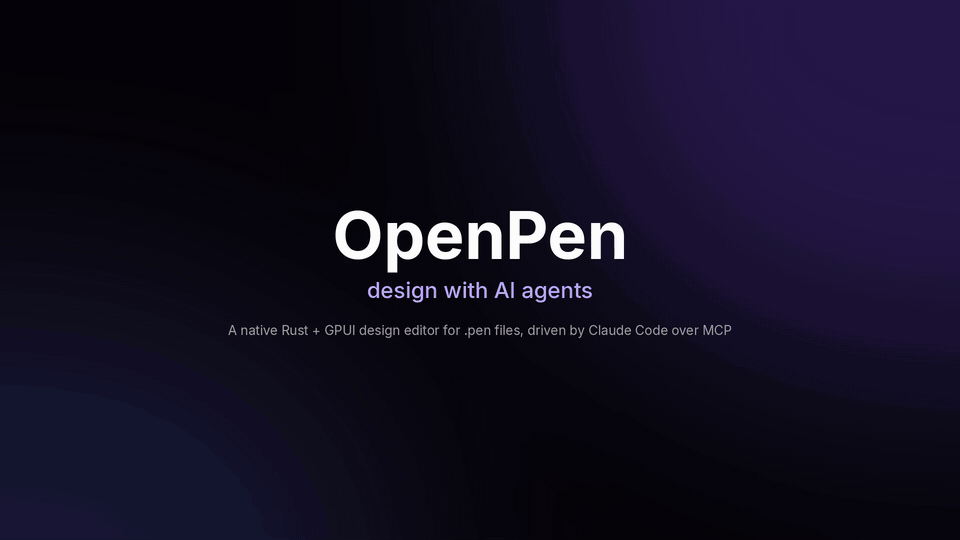
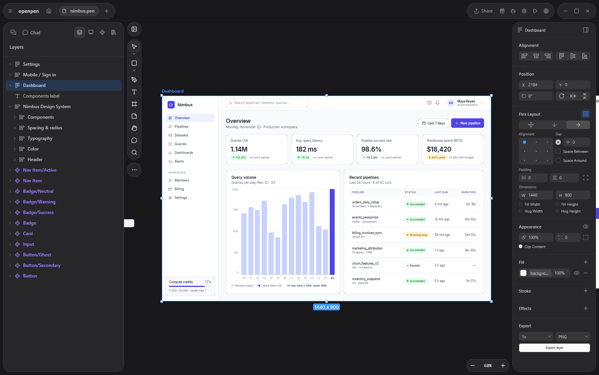
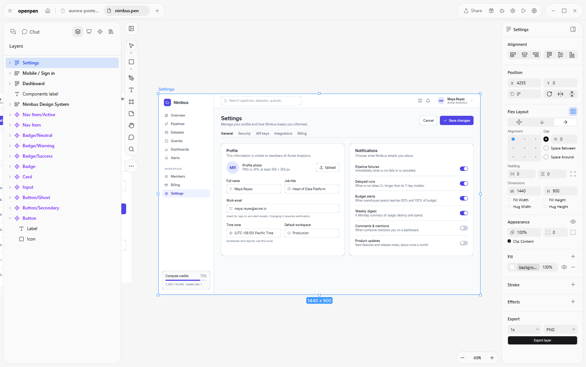
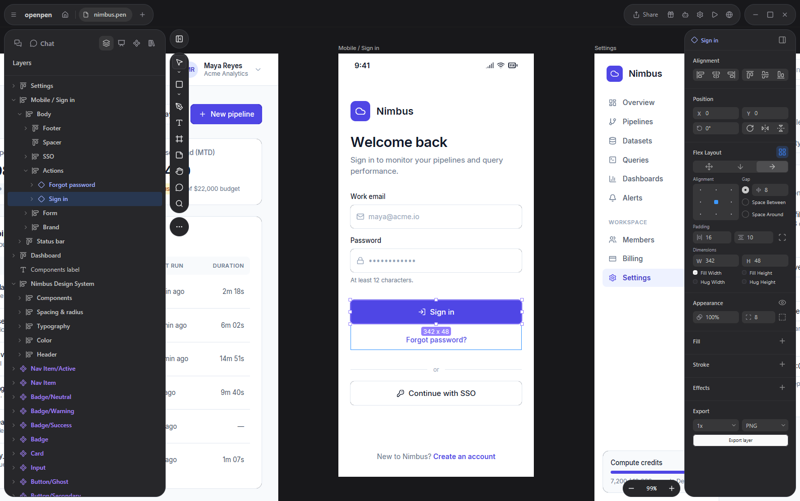
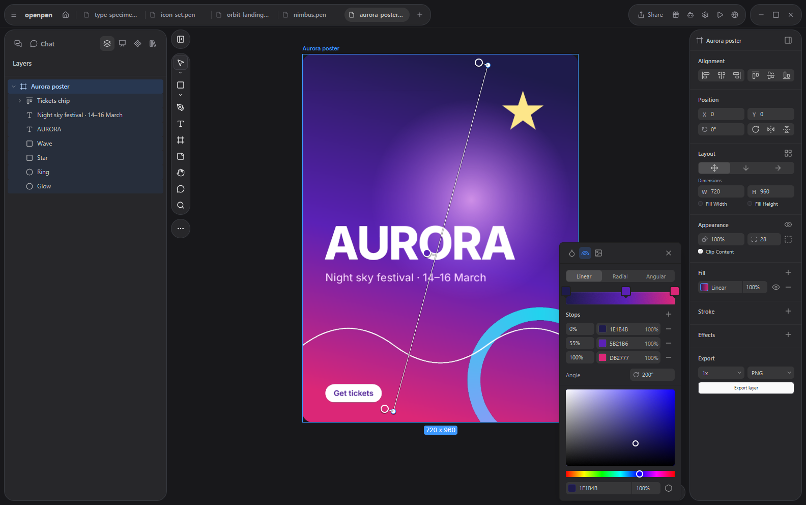
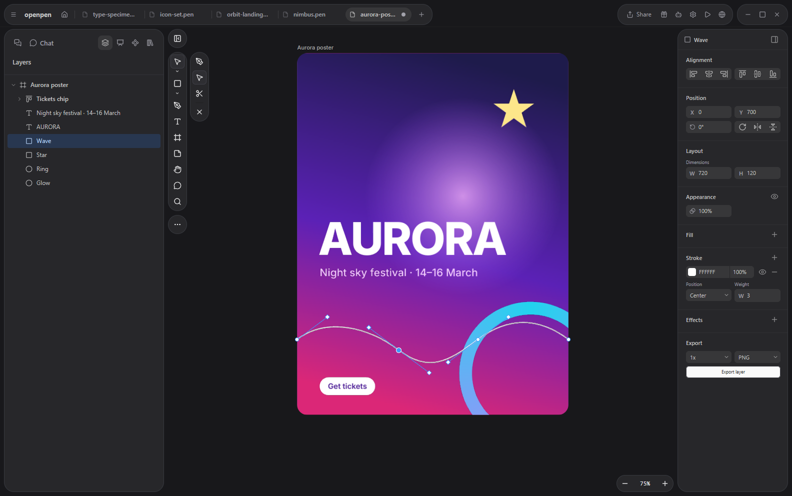
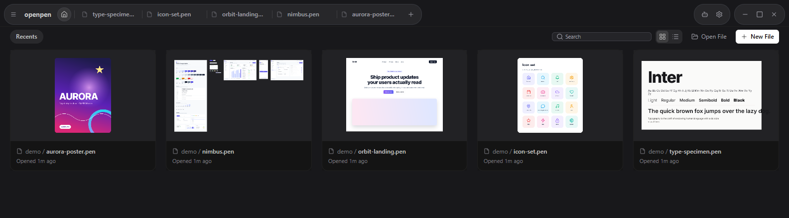
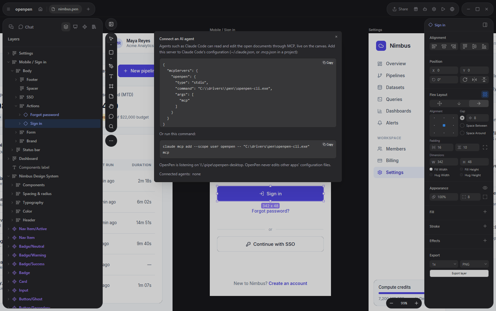
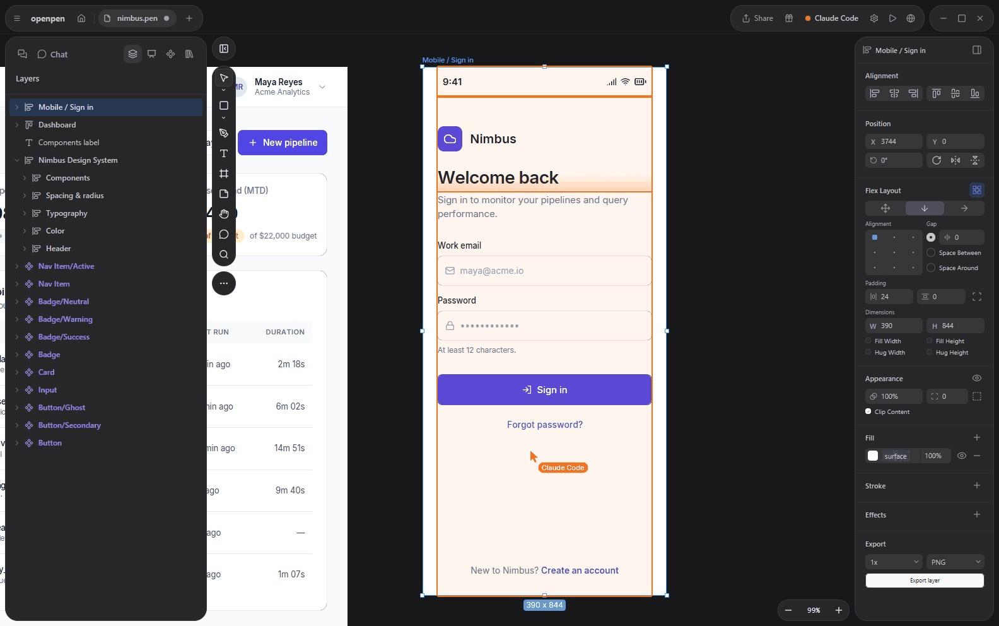
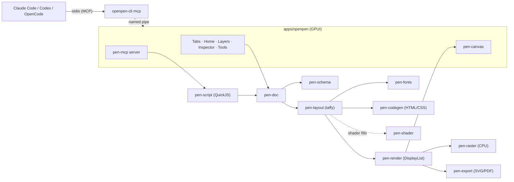

<div align="center">

# OpenPen

**A native, GPU-accelerated design editor for `.pen` files, built in Rust and made to be driven by AI agents.**

[](https://www.rust-lang.org/)
[](#build-from-source)
[](https://www.gpui.rs/)
[](#use-with-claude-code)
[](LICENSE)



<sub>Real recording, idle stretches sped up: from two prompts, Claude Code builds a design system and three screens in OpenPen over MCP. Every edit is one undo step. [MP4 version](docs/media/openpen-demo.mp4)</sub>

</div>

---

OpenPen is a desktop design editor written from scratch in Rust on top of [GPUI](https://www.gpui.rs/).
It reads and writes the open `.pen` format used by [Pen (pen.dev)](https://pen.dev) without losing data, and its
interface follows the original app. AI agents get a first-class seat: the app runs a local
[Model Context Protocol](https://modelcontextprotocol.io) server, so Claude Code, Codex, OpenCode and other
MCP clients can read the open document and edit it live while you watch. The canvas shows where they work.

> OpenPen is an independent project. It is not affiliated with, endorsed by or sponsored by Pen or High Agency.
> "Pen" is mentioned only to describe file-format compatibility.

## Why OpenPen

- **Native and fast.** No Electron and no web view. The canvas draws on the GPU through GPUI. A 1.4 MB document opens in about 50 ms, and pan/zoom stays at 60 fps on large files.
- **Built for agents.** Agents edit through a small transactional JavaScript API (`execute`). Each call is one undo step, and a failing call rolls back completely. The canvas flashes the nodes an agent touched and shows the agent's cursor and name.
- **Opt-in by design.** OpenPen never writes other apps' configuration files. You connect an agent with one command. All traffic is local IPC (a named pipe on Windows): no TCP port, no HTTP.
- **Headless too.** The same engine runs without a window (`openpen-cli`): validate, migrate and render `.pen` files to PNG/SVG/PDF, export them as HTML/CSS or Tailwind code, or serve a document to an agent over stdio in CI.
- **Lossless.** Unknown fields survive a load/save round trip, and `.pen` files from schema 1.0 to 2.22 are migrated on load.

## Features

<table>
<tr>
<td width="50%"></td>
<td width="50%"></td>
</tr>
<tr>
<td><b>Canvas, layers and inspector.</b> Frames with flex layout (<code>fit_content</code>, <code>fill_container</code>, gap, padding, alignment), text, shapes, icons, effects, and a dark theme...</td>
<td>...and a light one. Both follow the system setting, or force one with <code>--dark</code> / <code>--light</code>.</td>
</tr>
<tr>
<td></td>
<td></td>
</tr>
<tr>
<td><b>Components and instances.</b> Reusable components, variants, slots and per-instance overrides. Variables and theme axes (for example light/dark modes) are resolved live.</td>
<td><b>Fill editor.</b> Solid colors, linear, radial and angular gradients with on-canvas handles, image fills, and variable bindings.</td>
</tr>
<tr>
<td></td>
<td></td>
</tr>
<tr>
<td><b>Pen tool and vector editing.</b> Draw paths, edit anchors and Bézier handles, cut and join, and turn shapes into editable paths.</td>
<td><b>Home.</b> Recent documents with cached previews, grid/list views, search, rename and drag-and-drop to open.</td>
</tr>
<tr>
<td></td>
<td></td>
</tr>
<tr>
<td><b>Connect an AI agent.</b> The dialog gives the exact MCP config and <code>claude mcp add</code> command for your install, with Copy buttons.</td>
<td><b>Live agent feedback.</b> While an agent edits, its cursor visits the nodes it touched and each one flashes in the agent's color.</td>
</tr>
</table>

Also included:

- Procedural `script` nodes (JavaScript in QuickJS) and GLSL shader fills/strokes/effects (GPU through wgpu, with a CPU fallback).
  Shaders that use `@time` or `@mouse` animate while their node is selected and on screen, as in Pen; nothing animates (0% CPU) otherwise.
- Export to PNG (CPU rasterizer), and to vector SVG and PDF with real text and embedded fonts.
- Code export to HTML + CSS or HTML + Tailwind v4: flexbox layout, gradients, shadows, inline SVG icons and vectors,
  variables as CSS custom properties with theme blocks, and image assets copied next to the page.
- Bundled open-source fonts (Inter) and icon fonts (Lucide, Material Symbols, Phosphor), plus on-demand system fonts.
- Undo/redo in blocks (a whole gesture or agent call is one step), snapping, and keyboard shortcuts modeled on the original editor.

## Use with Claude Code

OpenPen ships an MCP server inside the app. `openpen-cli mcp` is a small shim that connects an MCP client
(over stdio) to the running app (over a local named pipe).

**1. Register the server once** (user scope, so it works in every project):

```powershell
claude mcp add --scope user openpen -- "C:\path\to\openpen-cli.exe" mcp
```

Or print the JSON entry for your install and paste it into `~/.claude.json` or a project `.mcp.json`:

```powershell
openpen-cli mcp --print-config
```

```json
{
  "mcpServers": {
    "openpen": {
      "type": "stdio",
      "command": "C:\\path\\to\\openpen-cli.exe",
      "args": ["mcp"]
    }
  }
}
```

The app shows the same snippet, with your real path, in **☰ › File › Connect an AI agent…** (or the robot icon in the tab bar).

**2. Open OpenPen**, open or create a `.pen` file, and ask Claude Code for a design:

```text
> In OpenPen, build a mobile login screen for "Nimbus" using the existing Button and Input components.
```

The agent calls `get_app_state`, loads the skill files with `start_task`, and builds the screen with `execute`.
You see the result appear on the canvas, the layers panel and inspector update, and **Ctrl+Z** undoes the whole call.

**Headless mode (no window).** Serve one document over stdio, for CI or servers:

```powershell
claude mcp add openpen-app -- "C:\path\to\openpen-cli.exe" mcp --headless C:\designs\app.pen
openpen-cli mcp --print-config --headless C:\designs\app.pen   # JSON form
```

Nothing is written to disk until the agent calls `save`. Add `--readonly` to keep the file untouched
(screenshots and `Export` still work). Other options: `--socket NAME` to target a second app instance
(`OPENPEN_MCP_SOCKET=NAME` on the app side) and `--agent NAME` to set the name shown on the canvas.

**OpenCode** (`opencode.json`):

```json
{
  "$schema": "https://opencode.ai/config.json",
  "mcp": {
    "openpen": {
      "type": "local",
      "command": ["C:\\path\\to\\openpen-cli.exe", "mcp", "--agent", "OpenCode"],
      "enabled": true
    }
  }
}
```

### Embedded chat

OpenPen also has its own chat: press **Ctrl+K** (or open the **Chat** tab of the left sidebar) in any
document. The agent edits that document live. Edits stream onto the canvas while the model is still
writing the code, and each `execute` is one undo step. Conversations are saved per document and
reopen with it.

Two engines, picked in the chat header:

- **Claude Code** (default) runs **your installed Claude Code** (`claude` on PATH), on your own
  account and subscription, connected to the app through `openpen-cli mcp`. By default it ignores
  your personal Claude Code hooks, plugins and settings (`--setting-sources ""`). Turn on **Use my
  Claude Code settings** to load them.
- **Anthropic API** calls the Messages API directly with your key. Paste the key in the chat
  settings. It is stored in the system credential store (Windows Credential Manager), never in
  OpenPen's files, and only a masked form is shown afterwards. `ANTHROPIC_API_KEY` also works. API
  usage is billed per token to your Anthropic Console account.

Model (Sonnet / Opus / Haiku, or an API model id) and effort are set in the same popover. Details:
[`docs/chat.md`](docs/chat.md).

### MCP tools

| Tool | What it does |
|---|---|
| `get_app_state` | Active document, selection, visible area, top-level nodes, components, variables and connected agents. |
| `start_task` | Loads the skill files the agent asks for (`SKILL.md`, `execute.md`, `pen-schema.md`) in one call. |
| `read_skill` | Reads one skill file. |
| `execute` | Runs a JavaScript snippet against the document as one transaction (one undo step). Fix a failed call with `editId` + `edits` instead of resending it. |
| `save` | Saves the document (same path as Ctrl+S). |
| `get_style` | Style presets (answers that presets are not available yet). |

All tools except `start_task` and `read_skill` take an optional `uri` (path or `file://` URI). Without it they target the focused document.

### The `execute` API in brief

Snippets run in QuickJS with a small set of globals: `Insert`, `Copy`, `Update`, `Replace`, `Move`, `Delete`,
`SetVariables`, `GetVariables`, `Get` (with an optional visitor), `FindEmptySpace`, `Print`, `TakeScreenshot` and `Export`
(`png`, `jpeg`, `webp`, `svg`, `pdf`, `html-css`, `html-tailwind`).
Any string that starts with `$` is a variable reference; write `"\\$18,420"` in JS for a literal dollar sign
(the response warns when a `$` value names no variable).
Limits: about 2 s of JavaScript CPU per call, 256 MiB of heap and 55 s in total.

```js
// inputId and buttonId are component ids kept as globals by an earlier call.
const pos = FindEmptySpace({ width: 390, height: 844, direction: "right", padding: 120 });
login = Insert(document, {
  type: "frame", name: "Login", x: pos.x, y: pos.y, width: 390, height: 844,
  layout: "vertical", gap: 16, padding: [64, 24], fill: "$background",
  children: [
    { type: "text", name: "Title", content: "Welcome back", fontFamily: "Inter",
      fontSize: 28, fontWeight: "700", fill: "$text" },
    { type: "ref", ref: inputId, name: "Email", width: "fill_container" },
    { type: "ref", ref: buttonId, name: "Sign in", width: "fill_container" },
  ],
});
TakeScreenshot([login]);
```

`login` (no `const`) persists for the agent's next call. The full guide the agent reads is in
[`skills/openpen/`](skills/openpen/SKILL.md).

## Build from source

Requirements:

- Windows 10/11 (the only platform tested so far).
- Rust stable with edition 2024 support (`rustup default stable`).
- **MSVC Build Tools** (Visual Studio "Desktop development with C++"): QuickJS (`rquickjs`) is compiled from C.
- Optional: [`just`](https://github.com/casey/just).

```powershell
git clone https://github.com/BrunoMoraes-Z/OpenPen
cd OpenPen
just build
# or, without just:
cargo build --release -p openpen -p openpen-cli
```

The binaries land in `target\release\`: `openpen.exe` (the app) and `openpen-cli.exe` (CLI and MCP shim).

To install them somewhere else, copy both executables **and the `skills` folder** so the layout is:

```text
C:\tools\openpen\
├─ openpen.exe
├─ openpen-cli.exe
└─ skills\
   └─ openpen\        (SKILL.md, execute.md, pen-schema.md)
```

The MCP server looks for `skills\openpen` next to the executable (or in a parent folder), or in `OPENPEN_SKILLS_DIR`.

Run the app with `openpen.exe [file.pen ...]`. Useful environment variables: `OPENPEN_DATA_DIR` (recents and
preview cache, default `%APPDATA%\OpenPen`) and `OPENPEN_MCP_SOCKET` (socket name, default `desktop`).
The log goes to `%TEMP%\openpen.log`.

Development: `cargo test --workspace`, `cargo clippy --workspace -- -D warnings`, `cargo bench -p <crate>`.

## CLI

```powershell
openpen-cli validate design.pen other.pen     # load, migrate in memory and validate (--strict, -v)
openpen-cli migrate old.pen -o new.pen        # upgrade to the current schema (2.22)
openpen-cli render design.pen -o out.png      # CPU rasterizer
openpen-cli render design.pen -o out.svg      # vector SVG with real text
openpen-cli render design.pen -o out.pdf --outline   # PDF, text as outlines
openpen-cli render design.pen -o card.png --node card1 --scale 2 --bg "#FFFFFF"
openpen-cli render design.pen -o dark.png --theme mode=dark
openpen-cli render design.pen -o t2.png --time 2   # animated shaders at t = 2 s (default 0)
openpen-cli export-code design.pen --node screen1 --format html-css -o site/       # index.html + styles.css + assets/
openpen-cli export-code design.pen --format html-tailwind -o site-tw/ --theme mode=dark
openpen-cli mcp [--headless file.pen] [--print-config]
```

## Architecture

The core compiles and is tested without a window. GPUI is used only in `pen-canvas` and `apps/openpen`.

| Crate | Role |
|---|---|
| `pen-schema` | Serde types for `.pen`, migrations 1.0 → 2.22, validation. Lossless round trip (unknown fields kept). |
| `pen-doc` | In-memory scene graph (arena + ids), components/instances/overrides, variables/themes, `DocOp` with inverses (block undo). |
| `pen-fonts` | Bundled fonts (Inter, icon fonts) and an on-demand catalog of system fonts. |
| `pen-layout` | Flex layout on [taffy](https://github.com/DioxusLabs/taffy), text with cosmic-text, vector geometry, DisplayList building. |
| `pen-render` | Backend-agnostic `DisplayList`. |
| `pen-raster` | CPU backend (tiny-skia + cosmic-text): headless rendering, PNG export, golden tests. |
| `pen-export` | Vector SVG and PDF export from the DisplayList. |
| `pen-codegen` | HTML + CSS and HTML + Tailwind code export from the scene and its layout. |
| `pen-canvas` | GPUI element that draws the DisplayList on the GPU: pan/zoom, culling, per-chunk caches, CPU fallback for complex effects. |
| `pen-script` | The `execute` engine and `script` nodes (QuickJS through rquickjs), transactional. |
| `pen-shader` | GLSL shaders for fills/effects (naga front-end, wgpu on the GPU, CPU evaluator), animated `@time`/`@mouse`. |
| `pen-mcp` | MCP server ([rmcp](https://github.com/modelcontextprotocol/rust-sdk)): stdio, local socket and shim, decoupled from the engine through a `ToolBackend` trait. |
| `pen-agent` | Agent core of the embedded chat: Claude Code CLI or Anthropic Messages API engines, one normalized event stream. |
| `apps/openpen` | The GPUI app: windows, tabs, Home, layers, inspector, toolbar, tools, agent integration, embedded chat. |
| `apps/openpen-cli` | Headless CLI: `validate`, `migrate`, `render`, `export-code`, `mcp` (shim and headless server). |



## Performance

Measured on Windows 11, release builds (details in the docs listed below):

| Scenario | Result |
|---|---|
| Open a 1.4 MB, ~3,000-node document (parse, migrate, scene, layout, DisplayList, cold process) | ~51 ms |
| Canvas stress test, ~11,200 items with the camera always moving | CPU p95 ≤ 7.2 ms per frame, locked at 60 fps |
| Drag step on that document (edit + incremental update) | ~31 µs |
| Incremental fill edit | ~15 µs |
| `execute` inserting 200 nodes in an empty document | ~14 ms |
| Empty `execute` call (fresh QuickJS runtime) | ~0.44 ms |
| Animated shader tick on the UI thread (4 animated fills on a 400-item page) | ~0.09 ms; ~2.3 ms per full frame incl. GPU renders |

Sources: [`docs/pen-doc-layout.md`](docs/pen-doc-layout.md), [`docs/pen-canvas.md`](docs/pen-canvas.md), [`docs/pen-script.md`](docs/pen-script.md), [`docs/scripts-shaders.md`](docs/scripts-shaders.md).

## Project status

OpenPen is young and under active development. Windows is the only platform tested so far.

**Done**

- [x] `.pen` schema 1.0 → 2.22: lossless load/save, migrations, validation
- [x] GPU canvas with culling, caching and level of detail; CPU rasterizer and golden tests
- [x] Flex layout, text, components/instances/slots/overrides, variables and themes
- [x] Selection, transform, snapping, layers panel, inspector, fill/gradient/image editor
- [x] Pen tool and vector point editing
- [x] Procedural `script` nodes and GLSL shaders
- [x] SVG/PDF/PNG export and the headless CLI
- [x] HTML/CSS and Tailwind code export (`openpen-cli export-code`, `Export(..., "html-css")`)
- [x] Animated shaders (`@time`, `@mouse`)
- [x] MCP server, live agent editing with cursor and flash, headless MCP mode
- [x] Home screen with recents and previews
- [x] Embedded chat panel (Claude Code or the Anthropic API, an agent loop inside the app)
- [x] Streaming `execute` (edits appear on the canvas while the agent is still writing the code)

**Planned**

- [ ] AI image generation (`Generate`) and stock images
- [ ] Browser import (capture a live web page into a design)
- [ ] macOS and Linux builds

## Documentation

The design and implementation notes in [`docs/`](docs/) are written in **Portuguese (pt-BR)**. Good starting points:
[`pen-mcp.md`](docs/pen-mcp.md) (MCP server), [`agent-integration.md`](docs/agent-integration.md) (live agents in the app), [`chat.md`](docs/chat.md) (embedded chat), [`streaming-execute.md`](docs/streaming-execute.md) (streaming `execute`),
[`pen-script.md`](docs/pen-script.md) (the `execute` engine), [`pen-canvas.md`](docs/pen-canvas.md) (GPU canvas) and
[`pen-schema-notes.md`](docs/pen-schema-notes.md) (file format), [`pen-codegen.md`](docs/pen-codegen.md) (HTML/CSS export)
and [`scripts-shaders.md`](docs/scripts-shaders.md) (scripts and shaders). The agent skill files in [`skills/openpen/`](skills/openpen/) are in English.

## Compatibility

OpenPen opens `.pen` files from schema 1.0 up to 2.22 and saves them back in the current schema, keeping fields
it does not understand. `.pen` is plain JSON with a published JSON Schema. Rendering differences from the original
app exist (for example text shaping and some blend/blur edge cases); they are documented in `docs/`.

OpenPen does not include or redistribute any code or assets from Pen. Pen and pen.dev are trademarks of their
respective owners, and OpenPen is not affiliated with them.

## Acknowledgements

OpenPen stands on [GPUI](https://www.gpui.rs/) (through `gpui-kit` and [gpui-component](https://github.com/longbridge/gpui-component)),
[taffy](https://github.com/DioxusLabs/taffy), [cosmic-text](https://github.com/pop-os/cosmic-text),
[tiny-skia](https://github.com/linebender/tiny-skia), [lyon](https://github.com/nical/lyon),
[rquickjs](https://github.com/DelSkayn/rquickjs), [naga/wgpu](https://github.com/gfx-rs/wgpu),
[rmcp](https://github.com/modelcontextprotocol/rust-sdk) and [svg2pdf](https://github.com/typst/svg2pdf).

Bundled fonts (embedded in the binary, see [`assets/fonts/LICENSES.md`](assets/fonts/LICENSES.md)):

| Font | Version | License |
|---|---|---|
| [Inter](https://github.com/rsms/inter) | 4.1 | SIL Open Font License 1.1 |
| [Lucide](https://lucide.dev) | lucide-static 0.563.0 | ISC |
| [Material Symbols](https://github.com/google/material-design-icons) (Outlined, Rounded, Sharp) | 2026-10-23 snapshot, static instances | Apache 2.0 |
| [Phosphor](https://phosphoricons.com) | 1.4.2 | MIT |

## License

OpenPen is released under the [MIT License](LICENSE).

Bundled fonts keep their own licenses (SIL OFL 1.1, ISC, Apache 2.0, MIT); see [`assets/fonts/LICENSES.md`](assets/fonts/LICENSES.md).
