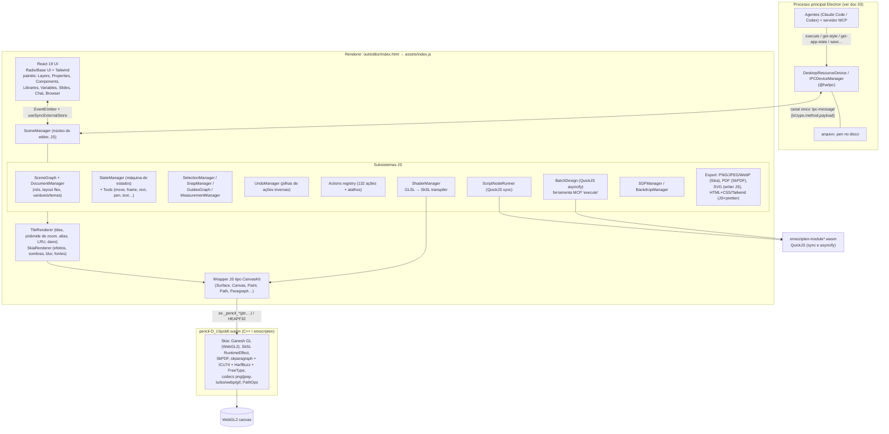

# 02 — Editor (renderer) e núcleo nativo de renderização

> Análise estática do Pen (pen.dev, High Agency) v1.2.23 (`desktop@1.2.23`, segundo o `SENTRY_RELEASE` embutido).
> Escopo: `out/editor/` (bundle React/Vite do renderer), `pencil-D_1SpsMI.wasm` (Skia via emscripten), os módulos QuickJS e os shaders.
> Método: greps direcionados no bundle minificado, leitura de trechos e um script Node que só **compila** (`new WebAssembly.Module`) os `.wasm` para listar imports/exports, sem instanciar nada.
> Documentos irmãos: `01-formato-pen.md` (formato do documento), `03-processo-principal-electron.md`, `04-mcp-headless-agentes.md`.

Legenda de confiança: **[confirmado]** = visto em código/strings; **[inferido]** = dedução razoável a partir de nomes e fluxo; **[incerto]** = hipótese.

---

## 1. Resumo executivo

- O **C++/WASM só renderiza**. `pencil.wasm` é uma build própria do **Skia** (Ganesh/WebGL2, SkSL, PDF, skparagraph + ICU + HarfBuzz + FreeType, codecs PNG/JPEG/WebP/GIF). Ele expõe uma **API C plana** (`pencil_*`, 397 funções) que funciona como uma "CanvasKit caseira", sem embind. **[confirmado]**
- **Todo o resto fica em JS/TypeScript**: grafo de cena, layout flex, hit testing, snapping, seleção, ferramentas, undo/redo, clipboard, exportação SVG/código, variáveis/temas, componentes/instâncias. **[confirmado]**
- O pipeline de renderização é um **tile renderer** em JS, com pirâmide de zoom, atlas, LRU e rastreio de dano (*damage tracking*). Ele chama o Skia para pintar cada tile num `SkSurface` WebGL2. Os overlays (handles, guias, medidas) também são desenhados com Skia. **[confirmado]**
- **QuickJS (quickjs-emscripten)** roda em duas variantes. A *sync* executa os **nós `script`** (geradores procedurais); a *asyncify* executa o código JS que os agentes de IA mandam pela ferramenta MCP `execute` ("batch design"). **[confirmado]**
- **Shaders**: arquivos `.glsl` (estilo WebGL1, com `gl_FragColor`/`texture2D`/`sampler2D`) são **parseados e transpilados para SkSL** dentro do JS e rodam como `SkRuntimeEffect`. Os uniforms são declarados com anotações JSDoc (`@label`, `@range`, `@default`, `@color`, `@time`, `@resolution`, `@mouse`, `@sdf`, `pencil:background`). **[confirmado]**
- UI em **React 19.2.3** com primitivas **Radix UI** e **Base UI**, Tailwind, ícones lucide/phosphor, i18n **formatjs** (8 idiomas), toasts **sonner**, **tiptap/ProseMirror** (input do chat), **Quill** (edição de texto no canvas), mermaid/katex/shiki (markdown do chat), **prettier** standalone (formatação do código exportado), zod, immer, PostHog e Sentry. Não há zustand, redux ou mobx: o estado vive em classes "Manager" com EventEmitter, e a ponte para o React é `useSyncExternalStore`. **[confirmado]**
- **Não há multiplayer em tempo real** entre humanos. O "Share" publica um *snapshot* com link, existe um *cloud sync* de arquivos, e os "colaboradores" ao vivo são **agentes de IA** com cursores próprios no canvas (`agentCursors`). **[confirmado/inferido]**

---

## 2. Arquitetura (diagrama)



Visão em camadas (ASCII):

```
+--------------------------------------------------------------+
|  React UI (painéis, toolbar, command palette, chat, dialogs)  |
+-------------------------- eventos ---------------------------+
|  SceneManager: SceneGraph | StateManager/Tools | Selection    |
|  Snap/Guides | Undo | Actions | Variables | Components        |
|  ScriptNodeRunner(QuickJS) | BatchDesign(QuickJS async)       |
+--------------------------------------------------------------+
|  TileRenderer / SkiaRenderer / Overlays (tudo em JS)          |
+--------------------------------------------------------------+
|  Wrapper JS "CanvasKit-like"  →  _pencil_* (API C)            |
+--------------------------------------------------------------+
|  pencil.wasm: Skia Ganesh/WebGL2 + skparagraph + SkPDF        |
+--------------------------------------------------------------+
```

---

## 3. Arquivos do editor

| Arquivo | Papel |
|---|---|
| `out/editor/index.html` | Shell com `<div id="root">`, CSP restrita (`connect-src` para `api.pen.dev`/`api.pencil.dev`, posthog, sentry, unpkg, unsplash, recraft). Título "Pencil", o nome antigo do produto. |
| `assets/index.js` (~11 MB) | Bundle Vite: React, todo o editor, o glue emscripten do `pencil.wasm` (embutido, offset ~3,87 MB), o wrapper Skia, os catálogos de i18n (cs, es, fr, id, ja, pt, zh + inglês nos `defaultMessage`), o parser GLSL, o importador Figma etc. |
| `assets/index-BJi2dmbc.css` | Tailwind compilado. Importa Inter, DM Sans e Roboto Mono do Google Fonts. |
| `assets/pencil-D_1SpsMI.wasm` (9,5 MB) | Skia (ver §4). |
| `assets/emscripten-module-B1g2L2eS.wasm` (1 MB) + `emscripten-module.browser.js` + `ffi.js` + `module-asyncify-*.js` | QuickJS na variante **asyncify** (funções `*_MaybeAsync`). |
| `assets/emscripten-module-uFzwHH0Y.wasm` (0,5 MB) + `emscripten-module2.browser.js` + `ffi2.js` | QuickJS na variante **sync**. |
| `assets/module-ES6BEMUI.js`, `index2.js` | Runtime do quickjs-emscripten (lifetimes, constantes `JS_EVAL_*`, intrinsics). |
| `assets/standalone.js`, `assets/html.js` | **Prettier** standalone + plugin HTML, usados para formatar o código exportado. |
| `assets/browserAll.js`, `assets/webworkerAll.js` | Chunks de ambiente do **pixi.js** (sistema de extensões/assets). No bundle principal aparecem só pedaços de `pixi.js/math` (Matrix, Point, ObservablePoint). **[incerto]** O pixi não parece ser o renderer principal. Talvez sirva apenas para a matemática de transformações ou venha como dependência transitiva. |
| `assets/highlighted-body-*.js` | Pequeno chunk de syntax highlighting (shiki) do chat. |
| `goodies/scripts/*.js` | 11 scripts de exemplo para nós `script` (clock, chart, gauge, radar, flow-field…). |
| `goodies/shaders/*.glsl` | 15 shaders de exemplo. |
| `goodies/shader-library/` | 107 `.glsl` em `assets/` e 75 exemplos `*.pen.json` com cenas que usam shaders, além de `provenance.json` e `image-sources.json`. |

---

## 4. `pencil.wasm`: o núcleo nativo

### 4.1 O que contém

- Os caminhos de build citam `/Users/jansedivy/Documents/scratch/pencil-wasm/third_party/skia/...`, ou seja, um projeto próprio que embute o Skia como `third_party`.
- As strings confirmam: `src/gpu/` (Ganesh, `GrGL*`), `src/sksl/`, `src/pdf/` (SkPDF), `modules/skparagraph`, `icudt74l` (ICU 74), `harfbuzz`, `FREETYPE_PROPERTIES`/`truetype-engine` (FreeType), `libpng`, `libjpeg-turbo 3.1.0`, `WEBPVP8/VP8L` (libwebp), decoder GIF (wuffs), zlib, um dicionário Brotli (provável suporte a WOFF2).
- Não há seção `name`. Os exports e imports têm nomes minificados (`Wc`, `Xc`…), mas o glue JS os remapeia para nomes C legíveis (`_pencil_canvas_draw_rect = H.kd`).
- **429 exports** (397 `pencil_*`, mais malloc/free/operadores new/delete) e **209 imports** (módulo `"a"`): as funções WebGL do emscripten (`GL.*`, `getContext("webgl2")`, `MAJOR_VERSION 2`), libc/syscalls, `invoke_*` para exceções C++ e o callback JS `pencilWriteStream`, que entrega bytes de PDF/encode ao JS.
- **Sem pthreads e sem SharedArrayBuffer**: é single-thread. Não existe embind; toda a interop passa por funções C com ponteiros opacos.

### 4.2 Exports agrupados por finalidade (397 funções `pencil_*`)

| Grupo | Qtde | Exemplos / observações |
|---|---|---|
| **Contexto GPU / Surface** | 18 + 13 + 1 | `make_webgl_gr_context`, `gr_context_{flush,submit,flush_and_submit,abandon,free_gpu_resources,purge_unlocked_resources,set_resource_cache_limit,max_texture_size,adopt_texture,reset_context…}`, `make_onscreen_gl_surface`, `surface_{make_raster,make_render_target,make_compatible_surface,make_image_snapshot,make_image_from_texture,draw_to_canvas,flush,get_canvas,width,height,sample_cnt,image_info}` |
| **Canvas** (desenho, clip, matriz) | 52 | `canvas_{clear,draw_rect,draw_rect_array,draw_rrect,draw_drrect,draw_circle,draw_oval,draw_arc,draw_path,draw_line,draw_points,draw_paint,draw_color*,draw_image*,draw_image_nine,draw_picture,draw_vertices,draw_patch,draw_atlas,draw_shadow,draw_text_blob,draw_glyphs,draw_simple_text,draw_paragraph}`, `save/save_layer/save_layer_rec/restore/restore_to_count`, `translate/scale/rotate/skew/concat_3x3/concat_4x4/reset_matrix/get_total_matrix/get_local_to_device`, `clip_rect/clip_rrect/clip_path/quick_reject/get_device_clip_bounds`, `read_pixels/write_pixels` |
| **Paint** | 29 | cor 4f/int, alpha, AA, dither, style, stroke width/cap/join/miter, blend mode, shader, color/image/mask filter, path effect, blender, copy |
| **Path / PathBuilder** | 32 builder + ~30 path | builder: move/line/quad/cubic/conic (absolutos e relativos `r_*`), `arc_to_{oval,rotated,tangent}`, `add_{rect,oval,rrect,circle,polygon,arc,path}`, `snapshot/detach`. path: `make_from_svg`, `to_svg`, **`make_from_op` (PathOps booleanos)**, `simplify`, `make_stroked`, `make_dashed`, `trim`, `make_as_winding`, `make_transformed`, `contains`, `compute_tight_bounds`, `get_segments`, `get_point`, `is_rect/oval/rrect`, `equals`, `write_to_memory` |
| **ContourMeasure** | 8 | comprimento, `get_pos_tan`, `get_segment` (texto em curva, trim de traço) |
| **PathEffect** | 9 | dash, corner, discrete, compose, sum, path1d, line2d, path2d |
| **Shader** | 10 | gradientes linear/radial/sweep/two-point-conical, cor, fractal noise, turbulence, blend, `with_local_matrix` |
| **RuntimeEffect (SkSL)** | 10 + 3 | `make_for_shader/color_filter/blender`, `uniform_count/size/at`, `make_shader` (com filhos), `make_color_filter`, `make_blender`, `blender_make_mode` |
| **ImageFilter** | 15 | blur, drop_shadow(_only), color_filter, compose, offset, matrix, blend, erode, dilate, shader, image, **displacement_map**, `get_output_bounds` |
| **ColorFilter / MaskFilter** | 8 + 2 | matrix, blend, compose, lerp, linear↔sRGB, luma; mask blur |
| **Image** | ~15 | width/height/info/unique_id, `make_shader(_cubic)`, `encode_to_bytes` (PNG/JPEG/WebP), `read_pixels`, `make_copy_with_default_mipmaps`, `reinterpret_color_space`, `images_deferred_from_encoded_data/from_picture` |
| **Picture** | ~10 | recorder begin/finish, `cull_rect`, `approximate_op_count`, `make_shader`, `serialize` |
| **Vertices** | 4 | malhas (provável uso em *mesh gradient*) |
| **Texto de baixo nível** | Font 21, Typeface 6, FontMgr 6, TextBlob 4, TypefaceProvider 3 | `font_get_glyphs/measure_text/get_widths`, `typeface_make_from_data`, eixos variáveis (`get_variation_design_parameters`), `text_blob_make_from_rsxform` |
| **Parágrafo (skparagraph)** | builder 10, style 13, text_style 25, paragraph 22, FontCollection 6, Unicode 2 | `paragraph_builder_{push_style,push_paint_style,add_text,add_placeholder,build}`, `paragraph_style_{text_align,direction,max_lines,ellipsis,height,strut_style,…}`, `text_style_{font_families,font_variations,font_feature,letter/word_spacing,half_leading,decoration*,shadow,locale…}`, `paragraph_{layout,paint,get_height,get_max/min_intrinsic_width,get_rects_for_range,get_glyph_position_at_coord,get_closest_glyph_info_at_coord,get_line_metric_at,get_word_boundary,get_path,get_unresolved_codepoints…}`, `font_collection_enable_font_fallback`, `unicode_make_icu` |
| **PDF** | 5 | `pdf_make_document`, `begin_page`, `end_page`, `close`, `dispose` (a saída sai em stream por `pencilWriteStream`) |
| **Alocação** | 25 | malloc/calloc/realloc/free, `_Znwm`/`_ZdlPv` etc. |

### 4.3 Como o JS chama o WASM

1. O glue emscripten (MODULARIZE/ESM) fica **embutido no `index.js`**. Ele carrega `pencil-D_1SpsMI.wasm` via `new URL(..., import.meta.url)` e, depois da instanciação, mapeia `n._pencil_xxx = H.<minificado>`.
2. `tfn()` inicializa o módulo e devolve um objeto com a **mesma forma da CanvasKit**: `Surface, Canvas, Paint, Path, PathBuilder, Shader, ImageFilter, ColorFilter, Vertices, ContourMeasure(Iter), Image, Images, RuntimeEffect, PDFDocument, FontMgr, Typeface, Font, TextBlob, Picture, PictureRecorder, MaskFilter, Blender, SkUnicodeImpl, TypefaceFontProvider, FontCollection, ParagraphBuilder, Paragraph, PathEffect, GrDirectContext`, os enums (`PaintStyle, BlendMode, TileMode, FillType, PathOp, TextAlign, FontWeight…`) e as funções `MakeWebGLContext`, `MakeOnScreenGLSurface`, `MakeSurface`, `MakeRenderTarget`. Fica guardado numa global (`ve`), que o resto do editor usa como `ve.Paint`, `ve.RuntimeEffect.MakeForShader(...)` etc.
3. Cada classe JS guarda um `ptr` e chama `se._pencil_*`. Os valores de retorno compostos usam um **buffer de rascunho de 256 bytes** (`Ea = _malloc(256)`) lido via `HEAPF32`/`HEAPU8`. Matrizes e arrays usam `stackSave/stackAlloc/stackRestore`. A liberação é **manual** (`delete()`/`dispose()`); quase não há `FinalizationRegistry`.
4. Streams de saída (PDF, encode) passam pelo callback `pencilWriteStream(id, ptr, len)`, que copia de `HEAPU8` para o consumidor JS registrado.
5. O contexto WebGL2 é criado pelo emscripten (`GL.registerContext`). O editor configura o `GrDirectContext` com cache de **512 MB**, lê `STENCIL_BITS`/`SAMPLES` para MSAA e trata `webglcontextlost/restored`. Se o GL falhar, o editor lança `HardwareAccelerationUnavailableError`.

### 4.4 O que está em C++ e o que está em JS

| Responsabilidade | Onde |
|---|---|
| Rasterização, GPU, SkSL, blend, filtros, PathOps, contour measure | **C++ (Skia)** |
| Shaping, quebra de linha, bidi, fallback de fontes, métricas e hit test de glifos | **C++ (skparagraph/ICU/HarfBuzz)**, consultado pelo JS |
| Encode PNG/JPEG/WebP, PDF vetorial | **C++** |
| Grafo de cena, propriedades, variáveis/temas, componentes/instâncias/slots | **JS** |
| Layout (auto layout flex) | **JS** (`zJe`: passes de medida e posição por eixo) |
| Hit testing de nós (`findNodeAtWorldPosition`, `getViewAtPoint`), handles, segmentos de path | **JS** (com `Path.contains` do Skia para geometria fina) **[inferido]** |
| Snapping, guias, medições, seleção, ferramentas, undo, clipboard | **JS** |
| Tiling, cache, compositor, agendamento de frames | **JS** |
| SVG export, HTML/CSS/Tailwind export, importador Figma | **JS** |

---

## 5. Pipeline de renderização (JS em cima do Skia)

- **`SceneManager`**: o objeto central, com cerca de 40 subsistemas: `variableManager`, `browserManager`, `scenegraph`, `documentManager`, `resourceLoader`, `camera`, `damageTracker`, `tileRenderer`, `skiaRenderer`, `agentCursors`, `guidesGraph`, `selectionManager`, `nodeManager`, `textEditorManager`, `fileManager`, `snapManager`, `measurementManager`, `documentSearch`, `canvasSpotlight`, `scrollbars`, `commentManager`, `undoManager`, `scriptManager`, `scriptNodeRunner`, `stateManager`, `assetManager`, `shaderManager`, `sdfManager`, `backdropManager`, `billingManager`, `imageGeneratorManager`, `imageTransformManager`, `svgGeneratorManager`, `iconManager`, `resizeHandles`, `slidesManager`, `actions`, `selectionProperties`.
- **`TileRenderer`** (`g_n`) é composto por um `TileCache` (`o_n`: níveis por zoom, *free lists*, LRU, dano por invalidação), um `Compositor` e um `Scheduler` (`m_n`). O scheduler distingue a fase "zoom em mudança", em que mostra a pirâmide reamostrada, da fase "zoom estável", em que repinta na resolução exata. Também conta frames desde o último movimento ou edição e faz *downsample* entre níveis. Os tiles ficam em **atlas** de texturas. A grade de pixels é um RuntimeEffect próprio.
- **`SkiaRenderer`** (`tCn`): `fontManager`, efeitos auxiliares (checkerboard, *skeleton shimmer* para conteúdo pendente, *hatch*), `silhouetteRenderer`, `blurRenderer`, `shadowRenderer`, `analyticShadowRenderer`, `layerBlurRenderer`, `textRenderer`, `sdfRenderer`.
- **Overlays** (bounding box, handles de resize/rotação, pontos do pen tool, guias de snap, rótulos de medida, nomes de frames, cursores de agentes) são desenhados com o mesmo Skia por cima dos tiles. A UI DOM flutua sobre o canvas em camadas `data-pencil-canvas-overlay`.
- **Efeitos com backdrop** (vidro, refração): o `backdropManager` captura o conteúdo atrás do nó e o entrega ao shader como `sampler2D` (`pencil:background`). Mipmaps são gerados quando o uniform tem `@mipmap`.
- **SDF**: o `sdfManager` gera e cacheia (com refcount, por hash do path, tamanho e DPI) um campo de distância da forma do nó, entregue aos shaders `@sdf`. O bundle contém a string "JFA", então a geração provavelmente usa *jump flooding* na GPU. **[inferido]**

---

## 6. Grafo de cena e documento em memória

- Tipos de nó no factory (`createNode`): `frame`, `group`, `rectangle`, `ellipse`, `line`, `polygon` e `path` (todos na classe de shape `T2`), `text`, `icon`, `note` (sticky note), `script`, `browser` (página web viva via `<webview>`), `broken_ref` e `root`. Instâncias de componente usam `ref` (`prototype`, `reusable`, `slot`, `childrenOverridden`).
- Cada nó tem `properties` com valores crus e `properties.resolved`, este já com **variáveis e tema** aplicados (`theme` no root). Há `supportedProperties`, `isInLayout()`/`hasLayout()`, matriz de mundo e `toLocal()`.
- Propriedades vistas na UI (namespaces `properties.*`): position, alignment, layout, appearance, blendMode, fill, fillEditor, **meshGradient**, stroke, effects, typography, fontAxis/fontWeight, icon, image/pendingImage, shader/shaderEdit, script/input, slot/component, theme/variablePicker/variableConflict, export, code, metadata, note, browser, vector, visibility.
- Pintura: `fill` é uma lista de `color | gradient | image | shader | mesh`. `stroke` tem `{align: inside|center|outside, thickness, cap, join, fill[]}`. `effect` aceita `shadow` (inner/outer), `blur`, `background_blur` e `shader`. Nos exemplos da shader-library, o tipo `shader` aparece como **fill** 305 vezes, como **effect** 132 e como **stroke** 5.
- **Layout**: auto layout no estilo flexbox, calculado em JS (`layout: none | horizontal | vertical`, `gap`, `padding`, `justifyContent`, `alignItems`, `layoutPosition: absolute`, `width/height`: número, `"$variavel"`, `fit_content(…)` ou `fill_container(…)`). `zJe(root)` roda medir(x), posicionar(x), medir(y), posicionar(y) e finaliza, só nos ramos marcados como sujos.
- **Documento ↔ processo principal**: o **renderer é o dono do documento em memória**. Fluxo **[confirmado]**:
  1. O renderer envia `initialized`.
  2. O main responde com `load-document-content` (o conteúdo) e `document-state`.
  3. O renderer faz o parse e chama `sceneManager.open(content)`. Há suporte a backup recuperado (`RecoveredBackup`).
  4. Para salvar, o renderer pede `save-resource`. O main chama de volta `serialize`, o renderer devolve `serializeDocument()` e o main grava o arquivo.
  5. Mudanças externas chegam por `watch-file`/`file-changed`. Undo/redo do menu nativo chegam como notificações `undo`/`redo`.

---

## 7. Interação no canvas

### 7.1 Máquina de estados e ferramentas

- `StateManager` (`Fwn`) mantém um `state` atual (idle/seleção, edição de texto, pen/path, apresentação, browser…), mais `handState` (pan), `zoomState` (Z segurado), `pressTracker` (clique simples/duplo) e `scaleTool`.
- Ordem de despacho do pointer-down: hand (botão do meio, ferramenta hand ou `Space`) → zoom → scrollbars → comentários → `state.onPointerDown`. Os handlers devolvem `Consumed`/`NotConsumed`.
- Ferramentas (`setActiveTool`): `move`, `hand`, `comment`, `scale`, `frame`, `text`, `sticky_note`, `rectangle`, `ellipse`, `pen`, `polygon`, `icon`, `script`, `browser`. Também há modos de path (`tools.path.pen`, `selectPoints`, `cut`) e um **eyedropper**.

### 7.2 Seleção, snapping, guias, medidas

- Seleção: clique, Shift para adicionar, Mod para *deep select*, arrasto para *box select* (combinável com Shift e Mod), Enter para filhos, Shift+Enter para o pai, duplo clique para entrar.
- **Snapping** (`vSn`): limiar de **5 px de tela** (`5/zoom` no mundo), por eixo, contra bordas e centros do pai (frame) e dos irmãos. Também faz snap ao longo de raio (pen tool), é desligado com Ctrl e não atua em filhos de auto layout. As configurações são `snapToObjects`, `roundToPixels` (snap à grade de pixels), `showPixelGrid`, `smallNudge`/`bigNudge`.
- `GuidesGraph` desenha a guia temporária durante a criação de shapes e os nomes de frames. O `MeasurementManager` mostra distâncias com rótulos Skia.
- **Não há réguas (rulers)** nem guias persistentes arrastáveis: só aparecem nomes de ícones "ruler". **[confirmado por ausência]**

### 7.3 Edição de texto

- O texto é renderizado pelo skparagraph. Durante a edição, o nó esconde o próprio texto (`hideText`) e o editor monta um **overlay DOM**: um `<input>` para textos de uma linha ou um **Quill** (só o formato `text`, texto puro) para multilinha. O overlay é posicionado com a matriz câmera×nó e copia fonte, kerning e baseline (`baselineProbe`). Ao sair, o editor grava `textContent` num bloco de undo e apaga o nó se estiver vazio.
- Ao criar texto com o text tool, o editor amostra o pixel sob o cursor (`tileRenderer.readPixel`) para escolher uma cor de contraste. **[confirmado]**

### 7.4 Undo/redo

- `UndoManager` (`Bkn`) mantém `undoStack` e `redoStack` de **listas de ações**. Cada ação implementa `perform(manager, inverseCollector)` e, ao executar, empurra sua inversa, no padrão *command* com inversão automática.
- As mutações acontecem dentro de blocos: `const blk = scenegraph.beginUpdate(); … scenegraph.commitBlock(blk, {undo: true|false})`. São cerca de 100 usos de cada. Antes de mexer na pilha, `stateManager.handleUndo()` pode consumir o undo, por exemplo dentro do pen tool. No modo de texto, o editor usa `document.execCommand("undo")`.

### 7.5 Copy/paste e drag

- Cópia interna: `text/html` com `<span data-pen-node-clipboard="base64(JSON)">`, mais `text/plain` com os IDs dos nós (útil para colar no chat de uma IDE ou agente). Há também `data-pen-property-clipboard` para copiar e colar propriedades.
- **Colar do Figma**: decodifica o HTML do Figma (`<!--(figma)…(/figma)-->`, `data-metadata`/`data-buffer`, formato **fig-kiwi**) e converte blend modes, stack/auto layout e sizing.
- Também aceita colar imagens, SVG, `text/uri-list` e HTML do "browser import" (a captura de DOM vira camadas editáveis).
- Comandos extras: *Paste to replace*, *Copy as PNG/SVG/JSON/HTML+CSS/HTML+Tailwind*. O drag de componentes usa o MIME `application/x-ha`.

---

## 8. Inventário de ações e atalhos

Registro central `an({...})` com **132 ações**. Cada uma tem `id`, rótulo i18n, categoria, escopo, palavras-chave (para a command palette), flags, analytics, `shortcuts[{keyCode, modifiers, ignoredModifiers, platform}]`, `enabled(ctx)` e `run(ctx)`. Os modificadores são bits: `1 = Mod` (⌘/Ctrl), `2 = Shift`, `4 = Alt`, `8 = Ctrl`. As ações de UI emitem `uiCommand` com um número.

### 8.1 Ferramentas

| Ferramenta | Atalho |
|---|---|
| Move | V |
| Hand | H (ou segurar Space; botão do meio) |
| Comment | C |
| Scale | K |
| Frame | A ou F |
| Text | T |
| Sticky note | N |
| Rectangle | R |
| Ellipse | O |
| Pen | P |
| Polygon, Icon, Script, Browser | (sem atalho) |
| Eyedropper | I |
| Zoom (segurar) | Z (Z+clique aproxima, Z+Alt+clique afasta, Z+arrasto dá zoom na região) |

### 8.2 Edição / arranjo

| Ação | Atalho |
|---|---|
| Undo / Redo | Mod+Z / Mod+Shift+Z |
| Copy / Cut / Paste | Mod+C / Mod+X / Mod+V |
| Paste to replace | Mod+Shift+R |
| Copy as PNG | Mod+Shift+C |
| Copy as code | Mod+Alt+C |
| Duplicate | Mod+D (Alt+arrasto duplica) |
| Delete | Backspace / Delete |
| Group / Frame selection / Ungroup | Mod+G / Mod+Alt+G / Mod+Backspace ou Mod+Shift+G |
| Add / Remove flex layout | Shift+A / Shift+Alt+A |
| Align L/C(h)/R/T/M(v)/B | Alt+A / Alt+H / Alt+D / Alt+W / Alt+V / Alt+S |
| Text align L/C/R/J | Mod+Alt+L / T / R / J |
| Flip H / V | Shift+H / Shift+V |
| Rotate 90° L/R | (sem atalho) |
| Bring to front / forward / backward / back | `]` / Mod+`]` / Mod+`[` / `[` |
| Nudge | setas (Shift = nudge grande). Em auto layout, as setas reordenam os filhos |
| Create component / Detach component | Mod+Alt+K |
| Detach instance | Mod+Alt+X |
| Replace inside instance | Shift+Alt+R |
| Go to component, Make/Remove slot, Convert script to layers | (sem atalho) |

### 8.3 Seleção / navegação / visualização

| Ação | Atalho |
|---|---|
| Select all / Deselect | Mod+A / Esc |
| Select parent / Edit selection (entrar) | Shift+Enter / Enter |
| Zoom in / out / 100% | Mod+= / Mod+- / Mod+0 (e equivalentes do numpad) |
| Zoom to fit / selection | Shift+1 / Shift+2 |
| Zoom 50% / 200% | (sem atalho) |
| Pan | scroll (Shift+scroll = horizontal), Mod+scroll = zoom |
| Pixel grid / Snap to pixel grid | Mod+' / Mod+Shift+' |
| Comment markers | Shift+C |
| Hide UI / Show UI | Mod+\ / Esc |
| Find layers | Mod+F ou Mod+Shift+F |
| Command palette | Mod+P |
| Keyboard shortcuts | ? (Shift+/) |
| Presentation start / stop, next / prev slide | Mod+Enter / Esc, setas |
| Browser node: reload / back / forward / URL | Mod+R / Mod+← / Mod+→ / Mod+L |

### 8.4 Arquivo / chat

| Ação | Atalho |
|---|---|
| Save / Save as | Mod+S / Mod+Shift+S |
| New file / Open file / Close tab | Mod+Shift+N / Mod+O / Mod+W |
| Show chat / Full screen chat / New chat | Mod+K / Mod+Shift+\ / Mod+T |
| Próxima / anterior aba de chat; histórico de prompts | Ctrl+Tab / Ctrl+Shift+Tab; ↑ ↓ |
| Export selection PNG/JPEG/WebP/PDF/SVG, Export code to file, Export/Import snapshot, Share, Rename | (menu/palette) |

### 8.5 Pen tool / edição de pontos (da tela de ajuda)

| Ação | Gesto |
|---|---|
| Adicionar ponto | clique |
| Mover ponto sem desenhar | Alt+arrasto |
| Inserir ponto no segmento | Alt+clique |
| Alternar suave/canto | duplo clique no ponto |
| Puxar handles simétricos / quebrar simetria | Mod+arrasto / Alt+arrasto |
| Curvar segmento / sem mover vizinhos | Mod+arrasto / Mod+Alt+arrasto |
| Endireitar segmento | Mod+duplo clique |
| Selecionar pontos conectados | duplo clique no segmento |
| Selecionar todos os pontos / conectar pontos | Mod+A / Mod+J |
| Apagar pontos, segmentos ou handles | Backspace |

---

## 9. Painéis e UI

- **Barra lateral esquerda** (abas): Layers (com busca), Slides (frames como slides, export PDF), Components, Libraries (`.lib.pen` importáveis: `import-library`, `list-libraries`, `browse-libraries`).
- **Barra lateral direita**: Properties/Inspector, com as seções do §6.
- **Variables panel** (tokens, temas, conflitos de variáveis ao colar ou importar), **Browser panel** (navegador embutido para importar sites e localhost como camadas) e **Chat com agente** (Claude Code / Codex via processo principal, com histórico, permissões de ferramentas, *steer*/*stop*, anexos e contexto do workspace).
- Outros: command palette, diálogo de atalhos, comentários (com marcadores), "Goodies" (galeria de scripts e shaders), dashboard de documentos, onboarding, billing/usage, cloud sync, "Share a snapshot".
- Framework: React 19 com Radix (menus, popper, scroll area, accordion, collapsible) e Base UI, Tailwind, sonner, formatjs (`defaultMessage` em inglês + 7 catálogos), tiptap no input do chat e mermaid/katex/shiki na renderização de markdown.
- **Estado**: não há store global de terceiros. Os managers estendem um EventEmitter próprio (`bo`) com eventos como `selectionChange`, `selectionChangeDebounced`, `stateChange`, `actionStateChangeDebounced`, `cameraChangeDebounced`, `startTextEdit`/`finishTextEdit` e `uiCommand`. Os componentes React assinam via `useSyncExternalStore` (cerca de 60 usos).

---

## 10. IPC renderer ↔ main

- **Transporte**: o preload expõe `window.electronAPI = {sendMessage, onMessageReceived, resolveFilePath, initParams}` sobre um **único canal Electron `"ipc-message"`**. Por cima roda um protocolo RPC próprio (`@ha/shared` `IPCHost`), com mensagens `{id, type: "notification"|"request"|"response", method, payload, error}`. O mesmo código também roda como webview do VS Code/Cursor (`window.vscodeapi.postMessage`).
- **Renderer → main (request)**: `save-resource`, `read-file`, `write-file`, `stat-file`, `watch-file`, `unwatch-file`, `pick-files`, `pick-save-path`, `import-files`, `import-uri`, `rename-file`, `save-temp-file`, `get-file-uri-for-path`, `fetch-remote-asset`, `fetch-website-import`, `get-session`, `sign-in-via-web`, `get-device-id`, `usage-status`, `usage-consume`, `chat-*` (conversations, messages, save, delete…), `agent-*` (config-get, probe, steer, stop, set-api-key, mcp-config…), `skills-*`, `browser-node:*` (capture-page, screenshot, picker, import, scroll…), `tabs:load`, `dashboard:*`, `editor-crashed`, `get-mcp-config`, `toggle-mcp-integration` etc.
- **Renderer → main (notify)**: `initialized`, `selection-changed`, `send-prompt`, `submit-prompt`, `open-external-url`, `set-native-theme`, `locale-changed`, `titlebar-state`, `tabs:*`, `desktop-*` (new/open/save/close/update), `browser-node:*`, `file-changed`, `load-file`, `save-preview`, `cleanup-temp-files`, `sign-out`, `share-upload-changed`, `turn-into-library` etc.
- **Main → renderer (handle, o renderer responde)**: `serialize`, `save-document`, `import-library`, `list-libraries`, `remove-library`, `import-browser-clipboard`, `import-dom-snapshot`, `import-screenshot`, `permission-request`, `dashboard:confirm`, `reset-first-run-state` e as **ferramentas MCP de design** `execute`, `get-app-state`, `get-style`, `browser`, `save`, `read-skill`, `spawn-agents`, `start-task`, `import-website` (com billing: cada chamada consome uso e pode bloquear o agente).
- **Main → renderer (notify)**: `load-document-content`, `document-state`, `document-modified`, `file-changed`, `undo`, `redo`, `execute-streaming`, `spawn-agents-streaming`, `agent-session-event`, `connected-agents-changed`, `agent-config-changed`, `did-sign-in/out`, `set-theme`, `color-theme-changed`, `toggle-command-palette`, `toggle-ui-visibility`, `export-selection`, `import-images`, `open-settings`, `shader-changed`/`shaders-changed` (hot reload de shaders do disco), `tabs:state`, `desktop-update-*`, `usage-limit-reached`, `workspace-folder-changed` etc.

---

## 11. QuickJS: sandbox de scripts

### 11.1 Confirmação

`emscripten-module-*.wasm` contêm `vendor/quickjs/quickjs.c`, `libregexp.c` e `libunicode.c`. O FFI (`ffi.js`/`ffi2.js`) é o da biblioteca **quickjs-emscripten** (`QTS_NewRuntime`, `QTS_Eval`, `QTS_Eval_MaybeAsync`, `QTS_NewFunction`, `QTS_RuntimeSetMemoryLimit`, `QTS_RuntimeSetMaxStackSize`, interrupt handler, `QTS_bjson_*`, 68 funções). São duas builds: **asyncify** (B1g2L2eS, 1 MB, 110 exports) e **sync** (uFzwHH0Y, 0,5 MB, 75 exports). Ambas são carregadas sob demanda.

### 11.2 Nós `script` (geradores procedurais), runtime sync

- Cabeçalho JSDoc obrigatório:
  ```
  /**
   * @schema 2.10
   * @input nome: tipo(args) = default
   */
  ```
  Tipos de `@input`: `number` (com `min`/`max`, valores fora da faixa são *clamped*), `string`, `boolean`, `color`, `enum` (opções; valor inválido gera erro) e `ref`. O cabeçalho passa por um lexer/parser próprio, com mensagens de erro detalhadas.
- O código do usuário é embrulhado em `(pencil) => { …source… }` e recebe `pencil = { width, height, input: {…} }`, ou seja, o tamanho do nó e os valores dos inputs. **Precisa `return [nós]`**: um array de objetos no **mesmo esquema JSON do `.pen`** (`type: rectangle|ellipse|path|line|text|frame|ref…`, `fill`, `stroke`, `effect`, `geometry` SVG, `viewBox`, `textGrowth`…). O retorno é serializado com `JSON.stringify` e validado (`prepareScriptOutput`).
- **Determinismo**: antes de cada execução o runtime troca `Math.random` por um **mulberry32 com seed 0** (`__resetRng(0)`), de modo que o mesmo input sempre gera a mesma saída.
- **Limites**: memória de 16 MB, stack de 512 KB e **timeout de 2 s** via interrupt handler. Não há `fetch`, DOM, timers nem módulos: só o JS puro e o global `pencil`.
- Os inputs aparecem como controles no painel Properties (`properties.script`/`input`). A ação "Convert to layers" materializa a saída do script em nós reais.

### 11.3 "Batch design" (ferramenta MCP `execute` dos agentes), runtime asyncify

- O agente envia um trecho de JS que roda num contexto QuickJS persistente por agente, com 256 MB de memória e timeout de cerca de 2 s por chunk. O tempo gasto nas chamadas ao host é descontado do prazo. O código chega em pedaços por streaming (`execute-streaming`, com um `rechunker`).
- Funções do host injetadas no global:

  | Função | Operação |
  |---|---|
  | `__batchDesignI` | Insert (retorna o id) |
  | `__batchDesignC` | Copy (retorna o id) |
  | `__batchDesignR` | Replace (retorna o id) |
  | `__batchDesignM` | Move |
  | `__batchDesignD` | Delete |
  | `__batchDesignU` | Update |
  | `__batchDesignV` | Set variables |
  | `__batchDesignP` | Print |
  | `__batchDesignG` | Gera imagem (assíncrono) |
  | `__batchDesignT` | Screenshot (assíncrono) |
  | `__batchDesignX` | Export (assíncrono) |
  | `__batchDesignFindEmptySpace`, `__batchDesignGetVariables` | Utilitários |

- Um prelúdio (`batch_design_runtime.js`) cria a DSL de alto nível por cima dessas funções, com bindings persistentes como `document` e `root`. Detalhes no doc 04.

---

## 12. Shaders

- **Formato de entrada**: GLSL de fragmento no estilo WebGL1/ES2, com `void main()`, `gl_FragCoord`, `gl_FragColor`, `texture2D`, `textureSize` e `uniform sampler2D`. `in`/`varying` são proibidos ("The shader must not use anything but gl_FragCoord and uniforms!").
- **Compilação**: o JS tem um **parser GLSL completo** (AST com `declarator_list`, `function_call` etc., provavelmente `@shaderfrontend/glsl-parser`) e um **transpiler GLSL → SkSL**:
  - `main()` passa a ser `float4 main(float2 fragCoord_N)`. `gl_FragColor` vira uma variável local de retorno e `gl_FragCoord` vira o parâmetro.
  - `uniform sampler2D X` vira `uniform shader X`. `texture2D(t, uv)` vira uma função gerada `texture_N(int t, float2 p)` com `switch` que chama `X.eval(p)`. `textureSize` vira um uniform `int2` injetado, preenchido com o tamanho real da imagem.
  - Keywords são mapeadas (`vec*` → `float*` etc.).
  - O resultado vai para `RuntimeEffect.Make(sksl)` (Skia) e é instanciado com `makeShaderWithChildren(uniforms, childShaders, localMatrix)`. A matriz inverte o Y para emular a origem do GL, e cada textura filha leva uma matriz que normaliza as UVs para 0..1.
- **API de uniforms** (anotações JSDoc antes de cada `uniform`):

  | Anotação | Efeito |
  |---|---|
  | `@label Nome` | rótulo no inspector |
  | `@default v` | valor padrão (`pencil:background` = backdrop atrás do nó) |
  | `@range min, max` | slider |
  | `@color` | `vec3`/`vec4` como seletor de cor |
  | `@time` | tempo de animação (segundos), injetado pelo host |
  | `@resolution` | tamanho do nó em px (`vec2`) |
  | `@mouse` | posição do ponteiro ou ponto de luz arrastável |
  | `@sdf` | textura com o SDF da forma do nó |
  | `@mipmap` | gera mipmaps para a textura (blur barato) |

  Tipos aceitos: `float/vec2/3/4`, `int/ivec*`, `bool/bvec*`, `sampler2D`.
- **Uso no documento**: `{ "type": "shader", "enabled": true, "url": "goodies/shader-library/assets/x.glsl", "uniforms": { "u_ior": 2, … } }` dentro de `fill`, `effect` ou `stroke`. A animação depende de `animationsAndEffectsEnabled`. O main observa os arquivos e avisa com `shader-changed`.

---

## 13. Exportação

| Formato | Implementação |
|---|---|
| PNG / JPEG / WebP | Renderização offscreen com Skia e `image_encode_to_bytes`. O main tem `png-encode-worker` e `png-display-p3` para PNG em Display P3. |
| PDF | **SkPDF** (`pencil_pdf_*`): seleção ou slides viram páginas, em vetor. |
| SVG | **Writer JS próprio** (`pnt`/`gCn`), que percorre os nós e gera markup. Efeitos que não existem em SVG viram *rasters* embutidos. O Skia não tem export SVG aqui, só `path_to_svg`. |
| Código | `html-tailwind` (padrão) ou `html-css`, gerados em JS e formatados com prettier. Modos de asset: `embed`, `relative` ou `absolute`. |
| JSON | Copy as JSON, no esquema `.pen`. |
| Snapshot | Export/Import de pacote do documento (`write-snapshot-import`), usado também pelo Share. |

---

## 14. Multiplayer / compartilhamento

- **Não há** CRDT/OT nem WebSocket de colaboração no editor: não aparecem yjs, automerge nem liveblocks, e os poucos matches de "yjs" e "WebSocket" são falsos positivos.
- O **Share** gera um *snapshot* publicado com link (criar, apagar, aviso de "New changes since last shared"). O **Cloud sync** sincroniza arquivos com status Synced/Syncing/Paused.
- A "presença ao vivo" é dos **agentes de IA**: `agentCursors` com rótulo e tamanho configuráveis, *agent flash* e `spawn-agents`, que roda vários agentes em paralelo no mesmo documento.

---

## 15. Implicações para Rust/GPUI

| Peça legada | Substituto sugerido em Rust | Notas |
|---|---|---|
| Skia via WASM (rasterização, filtros, PathOps) | **skia-safe** (opção mais fiel; Ganesh GL/Vulkan/Metal ou Graphite) **ou vello** (wgpu, compute) + **kurbo** (geometria) + **lyon/flo_curves/i_overlay** (booleanos) | Com skia-safe dá para portar quase 1:1, já que a API `pencil_*` é praticamente a da CanvasKit. Vello é mais "rust-native", mas faltam blur/drop-shadow/displacement prontos (implementar em wgpu) e não há PDF. Uma opção é usar vello no canvas e skia-safe para export PDF/raster de alta fidelidade. |
| GPUI como host | **GPUI** para janelas, painéis, inspector, layers, chat e command palette | O GPUI já tem um renderer próprio (Metal/Blade/wgpu) para UI, mas **não serve para o canvas de design** (sem paths arbitrários de alta qualidade, filtros nem shaders do usuário). Recomenda-se um elemento GPUI customizado que hospede uma superfície wgpu ou Skia (textura compartilhada) para o canvas, e GPUI puro para o resto. |
| Tile renderer JS | Reimplementar em Rust (tiles por zoom, LRU, damage) | Em nativo talvez baste um cache por nó ou por camada (`SkPicture` / vello `Scene` por subárvore) mais tiles só para zoom extremo. Manter a ideia de "pirâmide durante o zoom, repintura exata quando para". |
| Layout flex JS | **taffy** | Mapeia direto: `fit_content` → `auto`/`min-content`, `fill_container` → `flex-grow: 1` + `stretch`, padding/gap/justify/align, `layoutPosition: absolute`. Atenção à ordem de passes por eixo e ao arredondamento (`roundToPixels`). |
| skparagraph + ICU + HarfBuzz | **parley** (com swash/fontique) ou **cosmic-text** | Requisitos: quebra de linha, bidi, fallback por codepoint, eixos variáveis, letter/word spacing, half-leading, decoração, ellipsis/max lines, hit test de glifo para cursor e seleção, e paths de glifo (export SVG/PDF). Com skia-safe, o `skia_safe::textlayout` cobre tudo isso direto. |
| Edição de texto (overlay DOM com Quill) | Editor de texto nativo sobre o layout do parley/cosmic-text, ou o `TextInput`/IME do GPUI | Precisa de IME, seleção e undo integrados ao bloco de undo do documento. |
| QuickJS (nós script, batch design) | **rquickjs** (mesmo motor; mais compatível) ou **boa** (Rust puro) | Reproduzir os limites (memória, stack, interrupt por deadline), o `Math.random` determinístico (mulberry32, seed 0), o contrato `pencil = {width,height,input}` com retorno `[nós]` e o parser do cabeçalho `@schema`/`@input`. Para o batch design async, rquickjs tem suporte a futures/promises. |
| Shaders GLSL → SkSL | **naga** (GLSL→WGSL) + wgpu, ou continuar em SkSL via skia-safe `RuntimeEffect` | Com wgpu é preciso suportar o dialeto: `gl_FragCoord`/`gl_FragColor`, `texture2D` → amostragem de textura, injetar `textureSize`, uniforms em UBO e as anotações (`@time`, `@resolution`, `@mouse`, `@sdf`, `@mipmap`, `pencil:background`). Também é preciso gerar o SDF (JFA em compute) e capturar o backdrop (render-to-texture do que está atrás). |
| PDF (SkPDF) | skia-safe `pdf`, **krilla** ou **printpdf** | Krilla é uma boa opção Rust pura para PDF vetorial com texto. |
| Encode PNG/JPEG/WebP | crates **image**, **png**, **jpeg-encoder**, **webp** | Display P3 exige escrever chunk iCCP/cICP. |
| SVG export / import | Writer próprio + **usvg/resvg** (import e fallback de raster) | |
| Undo por ações inversas | Mesmo padrão em Rust (`enum Op` + inversa) ou snapshots com estruturas persistentes (`im`/`rpds`) | Manter a semântica de "bloco" (`beginUpdate`/`commitBlock{undo}`). |
| EventEmitter + useSyncExternalStore | Entidades/modelos do GPUI (`Model<T>`, `cx.notify()`, `observe`/`subscribe`) | Encaixa naturalmente. |
| IPC JSON-RPC sobre canal único | Sem processo separado: chamadas diretas. Para MCP/agentes, um servidor (stdio/HTTP) em tokio com o mesmo vocabulário (`execute`, `get-app-state`, `get-style`, `save`…) | Dá para manter compatibilidade com o MCP atual. |
| Clipboard (HTML com base64 JSON; Figma fig-kiwi) | **arboard** / clipboard do GPUI com formatos customizados; decoder **kiwi** (há implementações em Rust) para colar do Figma | |
| Browser node (`<webview>` do Electron) | **wry** (WebView do sistema) offscreen ou CEF | É a parte mais cara de portar. Vale considerar adiar. |

Sugestão de prioridade: (1) grafo de cena, undo e o esquema `.pen` (doc 01); (2) canvas com skia-safe dentro do GPUI; (3) taffy + parley; (4) ferramentas, snapping e seleção; (5) export; (6) rquickjs para scripts; (7) shaders (SkSL direto se usar skia-safe, o que evita o transpiler); (8) MCP/agentes.

---

## 16. Incertezas e pontos em aberto

- **pixi.js**: só aparecem fragmentos (math, extensões, assets/spritesheet). Não ficou claro se ele desenha algo. Tudo indica que o canvas é 100% Skia.
- **Hit testing fino** (stroke/fill de paths): não confirmei se usa `pencil_path_contains` ou geometria JS própria.
- **Geração do SDF**: a string "JFA" sugere jump flooding, mas não verifiquei se roda em shader Skia ou na CPU.
- **Booleanos de path** (union/subtract): o `path_make_from_op` existe, mas não há ação booleana no registro de ações. Talvez seja usado só internamente (clip/stroke outline) ou pelos agentes.
- **Rich text**: a edição usa Quill com o formato `text` (texto puro), o que sugere um único estilo por nó de texto. Não confirmei se o documento aceita *spans* com estilos mistos.
- **`document-modified`**: o renderer escuta essa notificação, mas não localizei quem a emite no main.
- O pacote `node_modules/@ha/headless` (`preview-process.mjs`) provavelmente roda o mesmo motor de render em Node para gerar previews. Fica para o doc 03/04.
