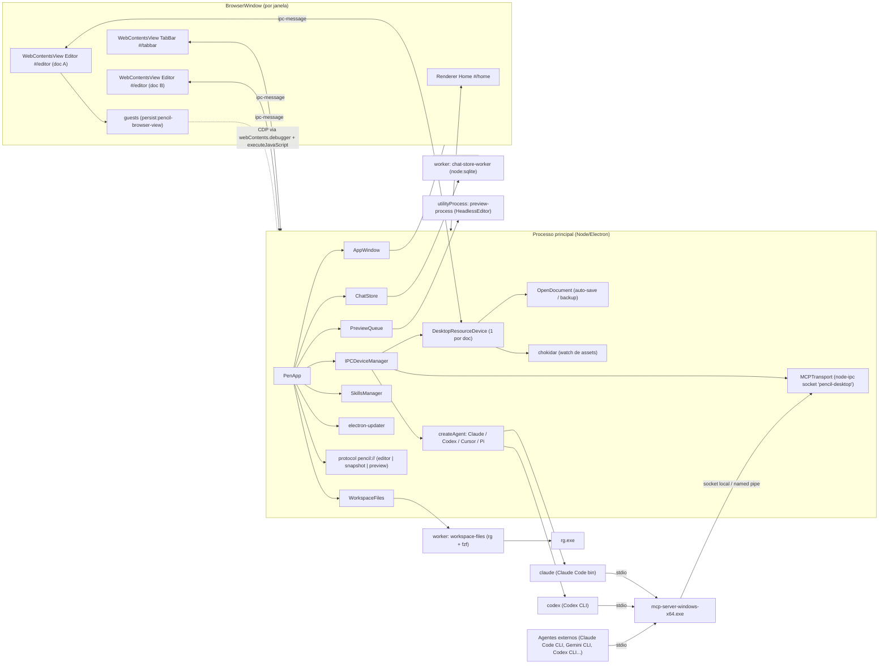

# 03 — Processo principal Electron e shell desktop (Pen v1.2.23)

> Engenharia reversa **somente para entendimento** do app legado "Pen" (pen.dev, High Agency), com o objetivo de projetar do zero uma ferramenta de design em Rust/GPUI.
> Fonte analisada: `app.asar` extraído (`out/*.js`, `out/browser-import/*`) + bibliotecas internas `node_modules/@ha/*` (há fontes `.ts` junto do `dist/`).
> Nada foi executado. Segredos encontrados no bundle (DSN do Sentry, chave do PostHog etc.) foram **omitidos de propósito**.
> O servidor MCP em si (`mcp-server-*.exe`, schemas de ferramentas) é coberto por outro documento; aqui ele aparece só no nível de "shell".

---

## 0. Resumo executivo

- O processo principal é um **orquestrador fino**: o "editor" de verdade (cena, renderização, serialização `.pen`, execução das ferramentas de agente) roda no **renderer** (`pencil://editor/#/editor`). O main cuida de janelas/abas, disco, diálogos nativos, persistência, agentes, MCP, previews e captura de páginas web.
- Cada documento aberto = um `WebContentsView` próprio (processo renderer isolado) + um objeto `DesktopResourceDevice` no main + um canal IPC JSON (`IPCHost`) dedicado.
- Persistência: arquivos `.pen` (JSON) com **escrita atômica**, auto-save com throttle de 5 s, **backup** separado para arquivos do usuário (`~/.pencil/backup/<sha1(uri)>`), "rascunhos gerenciados" em `~/.pencil/documents/<uuid>/untitled.pen`, chats em **SQLite** (`node:sqlite`, WAL) num worker thread, config em `electron-store`.
- Agentes (Claude Agent SDK, Codex SDK, Cursor SDK, "Pi") são criados no main; as chamadas de ferramenta do agente são roteadas **de volta ao renderer** do documento via IPC (`toolName` com `_`→`-`).
- Previews (thumbnails do Home) são renderizadas num **utilityProcess** que roda um "HeadlessEditor" (mesma engine do editor, provavelmente WASM) e grava PNG 512 px carimbado com o mtime do documento.
- "Browser import" = `<webview>` (Chromium) dentro do canvas ("browser nodes") + script injetado (`@ha/browser-inject`) que faz *crawl* do DOM com estilos computados, mais CDP (`webContents.debugger`) para screenshots, congelamento de animação etc. O resultado (`DomSnapshot`) é enviado ao renderer, que converte em nós `.pen`.

---

## 1. Modelo de processos

### 1.1 Inventário

| Processo / thread | Origem | Papel |
|---|---|---|
| **Main** (Node + Electron) | `out/main.js` → `PenApp` (`app.js`) | Orquestração, disco, diálogos, menus, agentes, MCP, updater |
| **Renderer "home"** | `BrowserWindow.webContents` carregando `pencil://editor/#/home` | Dashboard (Home), primeira "aba" implícita |
| **Renderer "tabbar"** | `WebContentsView` transparente por janela, `#/tabbar` | Barra de abas desenhada em HTML acima de tudo |
| **Renderer "editor"** (N) | Um `WebContentsView` por documento, `#/editor`, `webviewTag: true` | Editor/canvas, executa ferramentas dos agentes, serializa o documento |
| **Guests `<webview>`** | Dentro do editor, partição `persist:pencil-browser-view`, preload `browser-node-preload.js` | "Browser nodes" no canvas e barra lateral de navegador |
| **Popups do navegador** | `BrowserWindow` criadas por `window.open` dentro dos guests (com confirmação) | OAuth de sites etc. |
| **Janelas "popout"** | `AppWindow` adicionais (sem Home), offset de 32 px | Aba destacada em nova janela |
| Worker `chat-store-worker.js` | `worker_threads`, limite 512 MB de heap | SQLite de conversas |
| Worker `workspace-files-worker.mjs` | `worker_threads` | Lista arquivos com ripgrep + busca fuzzy (fzf) |
| Worker `png-encode-worker.js` | `worker_threads`, um por chamada | Codifica BGRA→PNG (com iCCP Display P3 opcional) |
| Worker do `pino-roll` | thread de transporte do pino | Log rotativo |
| **utilityProcess** `preview-process.js` | `utilityProcess.fork`, prioridade baixa, timeout 120 s | Renderiza thumbnails dos documentos (headless) |
| Processo `rg` (ripgrep) | spawn pelo worker de arquivos | Listagem do workspace |
| Processo **Claude Code** | Claude Agent SDK (`pathToClaudeCodeExecutable`) | Agente Claude |
| Processo **Codex CLI** | `@openai/codex-sdk` | Agente Codex |
| Cursor SDK / Pi | in-process (bibliotecas JS) | Agentes Cursor e "Pi" (multi-provider) |
| **`mcp-server-<os>-<arch>`** | Lançado via stdio **pelos agentes externos** (Claude Code, Codex, Gemini CLI…) | Servidor MCP que conversa com o app via socket local |
| Servidor HTTP loopback efêmero | `@ha/device-auth` (127.0.0.1, porta 0) | Callback OAuth/PKCE do login pen.dev |

### 1.2 Diagrama



Observação importante: para agentes rodando **dentro** do app, o Claude Agent SDK recebe o servidor MCP "pencil" como **SDK MCP server in-process** (`createSdkMcpServer`) cujos handlers chamam `inProcessToolHandler` → IPC ao renderer. O binário `mcp-server` é usado pelo Codex (stdio) e pelas integrações externas (arquivos de config de outras ferramentas).

---

## 2. Bootstrap e ciclo de vida do app

### 2.1 `main.js`
1. `dev-app-name.js`: em dev, renomeia o app para "Pen Dev" (separa userData/lock).
2. `Sentry.init` (main) — release `desktop@<versão>`, `sendDefaultPii: true`, desligado em dev; adiciona `Is Online` ao contexto.
3. `app.requestSingleInstanceLock()`; se falhar, sai. A instância dona do lock inicia o logger (`<logs>/main.log`).
4. `second-instance`: procura um argumento `*.pen` na linha de comando; se existir, `loadFile(file://…, zoomToFit=true)`, senão foca a janela.
5. Registra o esquema privilegiado **`pencil://`** (`standard, secure, supportFetchAPI, corsEnabled`).
6. `app.commandLine.appendSwitch("enable-blink-features","CSSImageAnimation")` — necessário para congelar GIF/animações nos "stills" de browser nodes.
7. `whenReady`:
   - Poda `~/.pencil/browser-previews` (diretórios com mtime > 30 dias).
   - macOS: recusa rodar de volume read-only (DMG) com diálogo localizado.
   - `protocol.handle("pencil")` com três hosts:
     - `pencil://snapshot/<id>` → bytes "one-shot" do `snapshot-store` (capturas grandes sem passar pelo IPC estruturado).
     - `pencil://preview/<nome>.png` → arquivos em `~/.pencil/previews` (regex `^[a-zA-Z0-9._-]+\.png$`).
     - `pencil://editor/<path>` → arquivos estáticos de `out/editor` (proteção contra path traversal). Em dev usa `http://localhost:3000`.
   - `new PenApp()` + `initialize(initArgs)`.
8. Eventos: `window-all-closed` (sai exceto macOS), `will-quit` (instala update pendente), `before-quit` (máquina de estados de saída), `activate` (macOS: reexibe janela), `open-file` (macOS: abre `.pen` ou guarda para depois da inicialização).

### 2.2 `PenApp.initialize`
Ordem: `AgentAuthStore.initialize` → migração de config (`configVersion`) → migração de API keys legadas do electron-store para o credential store (`didMigrateApiKeys`) → migração de nomes de rascunhos `pencil-*.pen` → `untitled.pen` → refresh de catálogos de modelos → `SkillsManager.refresh()` (não bloqueante) → `startMCPTransport()` (ao ficar pronto, `setupIntegrations`) → listener `open-temporary-document` → `setupUpdater` (só prod) → limpeza de artefatos do app antigo "Pencil" → `setupMenu` → decide *first launch* → restaura abas (`desktop-tabs.json`, descartando URIs `file:` inexistentes) ou abre o arquivo do argumento ou mostra Home → começa a salvar abas → `previewQueue.scan()`.

### 2.3 Saída (quit) — `quit-state.js`
Fases: `Idle → ClosingWindows → Approved`. `before-quit` chama `requestQuit()`: na primeira vez cancela o quit, entra em `ClosingWindows` e pede `requestCloseAll()` a cada janela (pergunta documento a documento; para no primeiro "Cancelar"). Se todos aprovarem: `cleanup()` (mata preview, para agentes, para MCP, encerra workers, fecha SQLite), `flushDesktopTabs()`, fase `Approved`, `app.quit()` de novo. Se cancelado, volta a `Idle` e regrava as abas.

Fechar janela: Windows/Linux → `app.quit()` (fluxo acima); macOS → apenas esconde (sai de fullscreen antes). Popout → fecha a aba ativa (a janela se destrói quando fica sem abas).

### 2.4 Crash do renderer de um documento
`render-process-gone` (≠ `clean-exit`): suspende serialização, grava o **último snapshot** conhecido (`writeLastSnapshot`), e mostra diálogo "pen.dev stopped running in {name}" com texto que depende do estado (nada perdido / últimos segundos podem faltar / backup falhou). Opções: Recarregar (`contents.reload()`) ou Fechar aba. Home/TabBar são recarregados automaticamente se caírem.

---

## 3. Janelas, abas, Home e barra de título

### 3.1 `AppWindow`
- Uma `BrowserWindow` (sem frame no macOS, `titleBarStyle: hiddenInset`, *traffic lights* posicionados dentro da "ilha" da tab bar; `autoHideMenuBar` no Windows). Tamanho padrão 1352×878, mínimo 560×400; bounds persistidos em `windowBounds` (só janela principal, fora de fullscreen). Cor de fundo `#18181b` (escuro) / `#f6f6f6` (claro).
- Filhos: N `WebContentsView` de editor (todos com bounds = janela inteira; só o ativo visível) + a `TabBar` (sempre re-adicionada por último para ficar no topo; altura `DESKTOP_TAB_BAR_HEIGHT = 8 + 42 = 50 px`).
- **Aba** = `{ id: URI do documento, loaded?: {device, ipc, titlebar, browserInset} }`. Abas restauradas ficam "não carregadas" até serem ativadas (lazy); se falharem ao abrir, são removidas e o Home é mostrado.
- `activeTabId === undefined` ⇒ Home ativo. Ao voltar para o Home, espera `home:shown` (até 150 ms) antes de esconder o documento, para evitar um frame vazio.
- Estado enviado para Home e TabBar: `tabs:state` (`DesktopTabsState`: lista de `DesktopTab {id,name,kind,source,isDirty,isReadonly,workspaceFolder}`, `activeTabId`, `isFullscreen`, `isPopout`, `titlebar`). `titlebar.cover = Hidden` esconde a TabBar (a view captura cliques mesmo transparente).
- `browser-inset`: quando a barra lateral de navegador abre, a TabBar é estreitada (`tabs:width {width, animate}`).
- Navegação bloqueada (`will-navigate`), `window.open` http(s) abre no navegador do sistema.
- Ações da barra de título (`DesktopTitlebarAction`: Share, Goodies, Settings, Account, Present, BrowserView, SignIn, WorkspaceMenu, Rename, AddToIDE) são roteadas como `titlebar-action` para o renderer da aba alvo (ou do Home).
- Menus de contexto nativos criados pelo main a pedido da TabBar: menu da aba (Renomear…, Revelar no Finder/Mostrar na pasta, Destacar em janela, Fechar aba, Fechar outras), "menu Pen" (links https recebidos do renderer, alternar tema, Mostrar/Ocultar UI `CmdOrCtrl+\`, docs da CLI `pen`), menu "nova aba" (Novo arquivo + recentes), e no Windows o menu da aplicação como popup.
- **Persistência das abas**: `<userData>/desktop-tabs.json` = `{ uris: string[], active?: string }`, escrito atomicamente, com dedupe e fila serial.

### 3.2 Home / Dashboard (`dashboard.js`, `dashboard-documents.js`)
Roda na página da própria janela (compartilha o IPC "home"). Lista: documentos *bundled* (kits shadcn/ui, HeroUI, Halo, Lunaris, Nitro — preview "Artwork"), rascunhos gerenciados e recentes (stat de cada arquivo: `createdAt`, `lastEditedAt`, `lastOpenedAt`, nome da pasta; preview "Snapshot" com URL `pencil://preview/<id>.png?v=<mtime>`).

---

## 4. Protocolo IPC

### 4.1 Transporte e envelope
- Canal Electron único: **`"ipc-message"`** (`ipcRenderer.send` / `webContents.send`). O `IPCElectron` filtra por `event.sender.id` (um host por `webContents`).
- `preload.js` expõe: `PENCIL_APP_NAME="Electron"`, `PENCIL_ARCH`, `IS_DEV`, e `electronAPI = { sendMessage, onMessageReceived, resolveFilePath(File) (webUtils.getPathForFile), initParams }`.
- `initParams` chega via argumento de processo `--init-params=<json>` (`DocumentInitParams`: `documentState`, `theme`, `connectedAgents`, `isFirstLaunch`, `hostVersion`).
- Envelope (`@ha/shared/ipc-types.ts`):

```ts
interface IPCMessage<T> {
  id: string;                       // "ext-<n>-<timestamp>"
  type: "notification" | "request" | "response";
  method: string;                   // nome do canal lógico
  payload?: T;
  error?: { code: string; message: string; stack?: string };
}
```
- Semântica (`IPCHost`, simétrico nos dois lados): `notify` (fire-and-forget), `request` (timeout padrão **60 s**; `-1` = sem timeout), `handle` (um handler por método), `on` (vários listeners). Códigos de erro: `METHOD_NOT_FOUND`, `HANDLER_ERROR`, `TIMEOUT`, `UNREACHABLE`, `DISPOSED`, além de códigos de domínio (`FILE_NOT_FOUND`, `FILE_NOT_PERMITTED`, `FILE_IS_FOLDER`). Pedidos pendentes são rejeitados em `render-process-gone`/`did-navigate`. Binários vão como `ArrayBuffer` (structured clone); capturas grandes usam `pencil://snapshot/<id>` para evitar jank.

### 4.2 Canais renderer → main (requests = `handle`, notificações = `on`)

**Comuns a qualquer página (Home e documentos)** — `IPCDeviceManager.registerAppHandlers` + `PenApp.registerAppIPC`:

| Método | Tipo | Payload → Resposta | Função |
|---|---|---|---|
| `get-session` | req | → `{email, token}?` | sessão pen.dev |
| `set-session` | notif | `{email, token}` | grava sessão; broadcast `did-sign-in` |
| `supports-web-auth-loopback` | req | → `{supported}` | sempre true no desktop |
| `sign-in-via-web` | req | `SignInViaWebOptions {apiBaseUrl, webBaseUrl, mode}` → `{email, token, slug?, profileUrl?}` | login web (progresso via `sign-in-via-web-progress`) |
| `cancel-sign-in-via-web` | notif | — | cancela |
| `sign-out` | notif | — | apaga sessão; broadcast `did-sign-out` |
| `get-device-id`, `get-last-online-at`, `set-last-online-at`, `get-current-workspace`, `set-current-workspace` | req/notif | — | identidade do dispositivo, modo offline (máx. 24 h), workspace de nuvem |
| `open-external-url` | notif | `{url, options:{showInFolder?}}` | só http/https/file |
| `agent-probe` | req | `AgentType` → `AgentProbeResult` | testa se um agente está conectado |
| `locale-changed` | notif | `{locale}` | atualiza idioma dos menus e persiste |
| `agent-config-get` | req | → config de agentes (modelos, login type, hints mascarados) | |
| `agent-set-api-key` | req | `{agentType, loginType, apiKey, provider}` | |
| `custom-provider-set` / `custom-provider-remove` | req | provedor OpenAI-compatível custom | |
| `agent-mcp-config-get` / `agent-mcp-config-set` | req | texto de `~/.pencil/mcp.json` | servidores MCP do usuário para os agentes |
| `agent-set-executable-path` / `agent-browse-executable-path` | req | caminho do binário `claude` | |
| `agent-set-use-http1` | req | Cursor HTTP/1 | |
| `agent-oauth-login` / `agent-oauth-logout` | notif | `{provider, enterpriseDomain?}` | progresso via `agent-oauth-login-update` |
| `get-active-integrations` / `toggle-mcp-integration` | req | integrações MCP externas | |
| `get-mcp-config` | req | → JSON da config stdio do servidor MCP | para o usuário copiar |
| `toggle-theme` / `set-native-theme` | notif | `{theme}` | |
| `desktop-open-terminal` | notif | `{workspaceFolder, agentType}` | abre Terminal/cmd rodando `claude`/`codex` |
| `show-about` | notif | — | |
| `desktop-update-install`, `set-install-on-app-quit` | notif | — | updater |
| `desktop-is-update-downloaded` | req | → bool | |

**Somente Home** (`dashboard.js`, `app-window.js`): `tabs:load` (req → `DesktopTabsState`), `titlebar-state` (notif), `home:shown`, `dashboard:load` (→ `DashboardDocument[]`), `dashboard:remove` (`{uris, removal: FromRecents|Delete}` → URIs removidas; Delete pede confirmação e só vale para rascunhos), `rename-file` (`{uri,name}`), `save-temp-file`, `cleanup-temp-files`, `dashboard:reveal`, `dashboard:open` (`{kind: NewFile, submission?} | {kind: Document, uri} | {kind: OpenDialog}`; `submission` = prompt inicial, arquivos, modelos, multiplicador de agentes etc.).

**TabBar**: `tabs:load`, `tabs:activate {id?, focus}`, `tabs:focus`, `tabs:dismiss-dialog`, `tabs:move {id,index}`, `tabs:close {id}`, `tabs:action DesktopTitlebarActionRequest`, `tabs:application-menu {anchor}`, `tabs:pen-menu {anchor, links, fromKeyboard}`, `tabs:new-menu {anchor}`, `tabs:context-menu {id, anchor}`, `dashboard:open`.

**Documento (editor)** — `IPCDeviceManager.addResource` (ver também §6):

| Método | Tipo | Função |
|---|---|---|
| `initialized` | notif | editor pronto → main responde `load-document-content` + `document-state`; retoma serialização |
| `file-changed` | notif | **o documento foi editado** (marca revisão; dispara auto-save) |
| `save-resource` | req → `DocumentSaveResult` | salvar (Ctrl+S vindo do renderer) |
| `editor-crashed` | req | força flush |
| `read-file` / `stat-file` / `write-file` | req | I/O de arquivos relativos ao documento (assets) |
| `watch-file` / `unwatch-file` | req | observar asset (refcount) → main notifica `file-changed(uri)` |
| `rename-file` | req | renomeia o documento |
| `pick-save-path` | req `SavePathOptions` → URI | diálogo "salvar como" genérico (exports) |
| `get-file-uri-for-path` | req | caminho relativo ao workspace → URI |
| `import-files` | req `ImportedFile[]` → `{fileURI}[]` | copia imagens/fontes/shaders/scripts para junto do doc |
| `import-uri` | req `{uri, kind}` | importa arquivo do disco por URI |
| `save-temp-file` / `cleanup-temp-files` | req/notif | arquivos temporários (clipboard) |
| `find-libraries` / `browse-libraries` / `turn-into-library` | req/notif | bibliotecas `.lib.pen` |
| `pick-files` | req | diálogo abrir + bytes |
| `pick-snapshot-extract-directory` / `write-snapshot-import` | req | importação de "snapshot" (zip compartilhado) para uma pasta |
| `read-skill-file` | req | lê arquivo do skill embutido `out/skills/pen-dev` |
| `load-file` | notif `{fileURI}` | abrir outro documento |
| `send-prompt` | notif (ver §13) | iniciar agente |
| `agent-stop` / `agent-steer` | req | parar / injetar mensagem num agente em execução |
| `submit-prompt` | notif | prompt para o painel do agente (caminho legado) |
| `open-temporary-document` | notif `name` | cria rascunho a partir de template (`new` ou `pencil-<nome>.pen`) |
| `toggle-design-mode`, `set-left-sidebar-visible` | notif | no-ops no desktop |
| `desktop:take-initial-prompt` | req | consome a submissão inicial vinda do Home |
| `get-fullscreen` | req | |
| `reload-window` | notif | flush + reload |
| `change-workspace-folder` / `open-workspace-folder` | notif | diálogo de pasta / abrir no explorer |
| `workspace-files-search` | req `{query, refresh}` → `string[]` | busca fuzzy de arquivos |
| `open-files-list` | req → caminhos de outros docs abertos | |
| `open-dashboard` | notif | |
| `agent-text-size-changed` | notif | sincroniza menu radio |
| `skills-list` / `skills-add` / `skills-remove` | req | skills (§14) |
| `chat-active-conversation-changed` | notif | |
| `chat-active-conversation`, `chat-conversations`, `chat-messages`, `chat-conversation`, `chat-message-data`, `chat-save`, `chat-delete` | req | armazenamento de chat (§11) |
| `share-upload-changed` | notif `{inProgress}` | bloqueia fechamento durante upload de share |
| `desktop-update-app`, `desktop-save-file {saveAs}`, `desktop-new-file`, `desktop-open-file`, `desktop-close-tab` | notif | comandos de UI |
| `add-extension-to-ide` | notif | abre `cursor:extension/highagency.pencildev` |
| `fetch-remote-asset` | req `{url}` → `{success, fileName, mimeType, fileContents}` | baixa imagem (sessão do navegador primeiro, depois rede padrão; ≤ 50 MB, timeout 15 s) |
| `browser-previews-cleanup` | req `{keepNodePaths, before}` | GC de previews de browser nodes |
| `browser-view:list-import-tests` | req | fixtures de teste (só dev) |
| `browser-node:*` | req/notif | ver §10 |

### 4.3 Canais main → renderer

**Notificações:** `document-state`, `load-document-content`, `file-changed` (asset observado mudou), `auto-save-failed`, `workspace-folder-changed`, `tabs:state`, `tabs:width`, `titlebar-action`, `titlebar-dismiss`, `titlebar-dismiss-dialog`, `fullscreen-change`, `set-theme`, `open-settings {section}`, `undo`, `redo`, `toggle-ui-visibility`, `set-agent-text-size`, `import-images`, `export-selection {format: pdf|svg|png|jpeg|webp}`, `open-export-snapshot-dialog`, `show-figma-import-guide`, `start-onboarding` (dev), `prompt-agent`, `ide-name-changed`, `dashboard:documents-changed`, `dashboard:preview-changed`, `agent-config-changed`, `active-integrations`, `connected-agents-changed`, `did-sign-in`, `did-sign-out`, `sign-in-via-web-progress`, `agent-oauth-login-update`, `desktop-update-ready`, `desktop-update-available`, `agent-session-event {conversationId, event}`, `execute-streaming`, `spawn-agents-streaming` (entrada parcial em streaming de ferramentas), `browser-node:*` (picker-state, picker-action, picker-labels, capture-progress, snapshot-frame, key, pointer-enter/leave, open-url, second-press).

**Requests (o renderer responde):**
- `serialize` (`SerializeRequest {fileURI, userInitiated, newFileToken, dependencyMove?}` → `SerializedDocument {content, libraries[], movedDependencies[]}`) — **o main nunca serializa a cena; sempre pede ao editor**.
- `get-app-state {conversationId}` — usado para "pré-aquecer" o prompt do agente.
- `permission-request {conversationId, toolName, input}` → `{result: allow|switch-to-auto|deny}` (sem timeout).
- **Chamadas de ferramenta do agente**: método = nome da ferramenta MCP com `_`→`-` (ex.: `batch_design`→`batch-design`), payload = `{conversationId, id: toolUseID, ...input}` → `{success, result:{message, image?, images?}, error}`. Timeout por ferramenta (`import_website` = 10 min; demais = padrão).
- `import-dom-snapshot {snapshot, imageUrls, fontUrls}` → `{success, error, result:{rootId, warnings}}`.
- `import-screenshot {name, images:[{fileURI,width,height}]}`.
- `reset-first-run-state` (dev).

---

## 5. Abstração "Resource Device"

Interface em `@ha/shared/resource-device.ts`; é o **contrato host ↔ editor** que permite o mesmo editor rodar em vários hosts (desktop Electron, headless para previews/CLI, e — pelos comentários — extensão VS Code/Cursor e web).

- **`AppHost`** (escopo app/conta): `getDeviceId` (desktop: `md5(hostname+platform+arch)`), `getHostVersion`, sessão (`get/setSession`), `get/setLastOnlineAt`, `get/setCurrentWorkspace`, `signOut`, `supportsWebAuthLoopback`, `signInViaWeb`/`cancelSignInViaWeb`, `openExternalUrl`, e parâmetros de agentes (`getAgentPackagePath`, `getAgentExecutablePath`, `getAgentLoginType`, `getAgentUseHttp1`, `getAgentEnv`, `getAgentApiKey`, `agentIncludePartialMessages`, `supportsWebsiteImport?`).
- **`ResourceDevice extends AppHost`** (escopo documento): `getResourceURI`, `getDocumentState`, `getDocumentContent`, `onDocumentStateChanged`, `readFile/statFile/writeFile/watchFile/unwatchFile`, `rename`, `pickSavePath`, `saveResource`, `editorCrashed`, `editorInitialized`, `submitPrompt`, `fileChanged`, `importFiles`, `importFileByUri`, `getActiveThemeKind`, `isFirstLaunch`, `getResourceFolderPath`, `dispose`, `saveTempFile/cleanupTempFiles`, `get/setWorkspaceFolderPath`, `getFileURIForPath`, `loadFile`, bibliotecas (`findLibraries`, `turnIntoLibrary`, `browseLibraries`), `pickFiles`, snapshots (`pickSnapshotExtractDirectory`, `writeSnapshotImport`), skills (`getSkills`, `readSkillFile`).
- Implementações: `DesktopAppHost` (só app; usado pelo Home) e `DesktopResourceDevice` (desktop; delega a parte AppHost ao `DesktopAppHost`); `HeadlessResourceDevice` (`@ha/headless`, com `LoopbackIPC` em memória).
- `IPCDeviceManager` (`@ha/ipc`) faz o *binding* genérico: dado um `IPCHost` e um `ResourceDevice`, registra todos os handlers acima (com `AbortSignal` para desregistrar), mantém mapas `uri → ipc/device`, documentos inicializados (`waitForDocumentReady`, timeout 15 s), agentes por conversa, último documento focado, e o transporte MCP.
- **Resolução de URIs** em `resolveFilePath`: `pencil:browser-<nodePath>` → `~/.pencil/browser-previews/<sha256(docURI)>/<sha256(nodePath)>.jpg`; `file:` → caminho; `pencil:<bundled>.pen` → `out/data/<arquivo>`; outro → relativo à pasta do documento.

---

## 6. Ciclo de vida do documento

### 6.1 Tipos de documento (`DocumentKind`)
| Kind | Identificação | Auto-save vai para | Observações |
|---|---|---|---|
| `File` | qualquer `file:` fora de `~/.pencil/documents` | **arquivo de backup** (o arquivo do usuário só muda em Save explícito) | pode ter pasta de workspace configurada |
| `Managed` (rascunho) | `file:` dentro de `~/.pencil/documents/<uuid>/` | **o próprio arquivo** | sem pergunta ao fechar; "Save As" move e apaga o rascunho |
| `Bundled` | `pencil:<nome>.pen` (`out/data`) | nenhum (read-only) | Save sempre vira Save As |

Documento novo = pasta `~/.pencil/documents/<randomUUID>/untitled.pen` com `{"version": CURRENT_SCHEMA_VERSION, "children": []}` ou cópia de um template bundled. Assets importados de rascunhos vão para subpastas `images/`, `fonts/`, `shaders/`, `scripts/`.

### 6.2 Abertura (`load-document.js` + `PenApp.openFile`)
1. Deduplica carregamentos concorrentes da mesma URI; se já aberto, foca a aba.
2. Lê o arquivo (utf8) e o mtime. Para não-bundled, verifica backup `~/.pencil/backup/<sha1(fileURI)>`:
   - arquivo mais novo que backup ⇒ apaga backup; conteúdo igual ⇒ apaga backup;
   - senão carrega o backup como `DocumentSource.RecoveredBackup` (fica "dirty" e pergunta ao fechar). Para `Managed`, move o backup por cima do arquivo (legado).
3. Cria `DesktopResourceDevice` + `WebContentsView` + `IPCElectron`, adiciona à `AppWindow`, registra todos os handlers, `recordDocumentOpened` (recentes), `loadURL(pencil://editor/#/editor)`, notifica `workspace-folder-changed` se configurada.
4. O renderer envia `initialized` → main manda `load-document-content {content, source}` + `document-state`.

### 6.3 Modelo de revisões e auto-save (`OpenDocument`, `@ha/shared/open-document.ts`)
- Contadores: `revision` (incrementa a cada `file-changed` do editor), `snapshot.revision` (última serializada), `savedRevision`, `autoSavedRevision`. Estados: `Unserialized` (editor tem mudanças não serializadas) → `Serialized` (main tem conteúdo ainda não no disco) → `Saved`. `isDirty = estado ≠ Saved`.
- Ciclo de vida: `Active` / `Suspended` (durante navegação, crash, save-as, rename) / `Closed`.
- Auto-save: em `markChanged`, se ativo e com destino, roda imediatamente um ciclo *serialize + write* e arma throttle de **5000 ms** para o próximo. Serializações e escritas em filas seriais (`TaskQueue`). Falha emite `auto-save-failed` (renderer mostra aviso). Falha de serialização ainda grava conteúdo antigo, mas reporta `DocumentUnreadable`.
- `flush()` antes de fechar/recarregar; `writeLastSnapshot()` grava o melhor conteúdo disponível sem consultar o editor (usado em crash/falha de save).
- Resultados (`DocumentSaveResult`): `Saved, NothingToSave, Cancelled, DiskFull(ENOSPC), NotPermitted(EACCES/EPERM), ReadOnlyDisk(EROFS), FolderMissing(ENOENT), FileInUse(EBUSY), DocumentUnreadable, WriteFailed` — cada um com texto de causa/conselho.

### 6.4 Escrita atômica (`file-io.js`)
`realpath` (segue symlink) → preserva permissões → cria `.<nome>.<uuid>.tmp` exclusivo na mesma pasta → write + `fsync` → `rename` com **3 tentativas a cada 100 ms** em `EPERM/EBUSY/EACCES` (antivírus/indexador no Windows) → `fsync` do diretório (exceto Windows). Usado para documentos, backups, recentes e abas.

### 6.5 Salvar / Salvar como (`DesktopResourceDevice.saveResource`, `save-document-as.js`)
- Mesmo arquivo: `document.saveTo(uri)` (pede `serialize` com `userInitiated: true`, escreve, apaga backup).
- Destino diferente (Save As, rascunho → disco, bundled → disco):
  - Recusa salvar dentro de `~/.pencil`.
  - Workspace de destino = workspace atual se o alvo estiver dentro dele; senão a pasta do alvo.
  - Se o workspace muda: cria pasta `<nome>-assets` (ou `-2`…`-100`) ao lado e pede ao editor `serialize` com `dependencyMove {assetFolderURI, sourceWorkspaceURI, targetWorkspaceURI}`; o editor reescreve referências e devolve `movedDependencies` (main copia com `COPYFILE_EXCL|FICLONE`) e `libraries` (gravadas com `wx`).
  - `newFileToken` = true para File/Bundled (nova identidade), false para Managed (mantém identidade).
  - Sucesso: fecha o doc antigo (descarta backup), registra workspace do novo, apaga o rascunho se Managed, e reabre o novo na mesma aba (`load-file` com `closeCurrent`, preservando a conversa ativa). Falha: remove a pasta de assets criada, grava backup e mostra erro.

### 6.6 Fechamento (`confirmClose`)
1. Upload de share em andamento → "Stay / Quit Anyway".
2. Se dirty e renderer vivo: `Managed` → flush silencioso (diálogo só se falhar: "Keep Open / Close Anyway"); `File` → "Save / Don't Save / [Don't Save and Discard Backup] / Cancel" (a 3ª opção só para backup recuperado; "Don't Save" mantém o backup recuperado); `Bundled` → descarta.
3. `dispose`: flush, close, fecha watchers.

### 6.7 Renomear (`rename.js`)
Valida nome (`.pen`, sem separadores, regras de nomes reservados do Windows), detecta colisão por `dev/ino` (case-only rename ok), salva se dirty, suspende serialização, remove backup órfão do alvo, `renameWithRetry`, move recentes, workspace configurado e preview; reabre o documento renomeado na mesma aba.

### 6.8 Bibliotecas
`.lib.pen`: `turnIntoLibrary` renomeia `x.pen`→`x.lib.pen` (com sufixos), `findLibraries` faz busca recursiva a partir da pasta do documento (ignora `node_modules`, `.git`, resolve symlinks com conjunto de visitados), `browseLibraries` usa diálogo.

### 6.9 Importação de arquivos para o documento
Para cada arquivo: tenta criar `base.ext` com `flag: "wx"`; se existir e for idêntico (comparação de bytes), reusa; senão `base-1.ext`, `base-2.ext`… Devolve `file:` URIs.

### 6.10 Observação de arquivos (chokidar 5)
`watchFile(uri)` com **refcount** por URI; `chokidar.watch(path, {ignoreInitial, awaitWriteFinish:{stabilityThreshold:100, pollInterval:50}})`; qualquer evento → `file-changed(uri)` ao renderer (para recarregar imagem/fonte/shader alterado externamente). **O próprio `.pen` não é observado** (não há reload de mudanças externas do documento nesta camada).

### 6.11 Recentes (`recent-files.js`)
`<userData>/recent-documents.json` = `{documents:[{uri, openedAt}]}` ordenado; máx. **200** entradas; bundled nunca entram; menu "Abrir recente" mostra os 14 primeiros que existem; migração da antiga lista `recentFiles` do electron-store.

### 6.12 Temporários e snapshots
- `os.tmpdir()/pen-clipboard/<uuid>-<nome>`: criados a pedido do renderer (colar do clipboard, anexos); limpeza só aceita caminhos diretamente nessa pasta.
- `snapshot-store.js`: mapa em memória `id → bytes` (máx. 16 pendentes, *one-shot*) servido por `pencil://snapshot/<id>`.
- "Snapshot" no sentido de compartilhamento = zip exportado/importado (`.zip`, `pick-snapshot-extract-directory`, `write-snapshot-import`, menu "Export snapshot").

---

## 7. Modelo de workspace / pastas

Há **dois conceitos** distintos:

1. **Pasta de workspace local** (por documento): raiz para caminhos relativos, busca de arquivos e `cwd` dos agentes.
   - Padrão = pasta do documento. Só documentos `File` podem configurar outra (`change-workspace-folder` → diálogo). Persistido em `electron-store.workspaceFolders: { [fileURI]: absPath }`; movido em rename/save-as.
   - Busca (`workspace-files-worker.mjs`): `rg --files --hidden --follow --no-require-git --no-config --no-messages --null --path-separator / --glob !.git !.hg !.svn !node_modules !.DS_Store`, limite 500 000 arquivos, ordena "rasos primeiro", índice `fzf` (v1, desempate por comprimento), 50 resultados, cache LRU de 4 workspaces, `refresh` responde com o cache e reindexa em background.
2. **Workspace de nuvem** (pen.dev): `UserCurrentWorkspace {organizationId, workspaceId?, slug, label}` guardado no arquivo de sessão; organizações pessoais/equipe com papéis `owner/admin/contributor/viewer`; itens de workspace (`.md .png .jpg .jpeg .zip`) via API (§12).

---

## 8. Menus e atalhos

Menu da aplicação (reconstruído a cada mudança de idioma, recentes ou update):

| Menu | Item | Atalho | Ação |
|---|---|---|---|
| (macOS) Pen | Sobre, Verificar/Reiniciar para atualizar, Configurações | `Cmd+,` | `open-settings` |
| File | New File | `CmdOrCtrl+Shift+N` | novo rascunho |
| | Open… | `CmdOrCtrl+O` | diálogo `.pen` |
| | Open Recent ▸ | — | 14 recentes + limpar |
| | Home | `CmdOrCtrl+N` | mostra Dashboard |
| | Import assets / Export selection ▸ PDF·SVG·PNG·JPEG·WebP / Export snapshot | — | notificações ao renderer |
| | Figma import guide, Install CLI (docs) | — | |
| | Save | `CmdOrCtrl+S` | `saveResource()` |
| | Save As… | `CmdOrCtrl+Shift+S` | `saveResource({saveAs})` |
| | Settings (Win/Linux) | `Ctrl+,` | |
| | Close Tab | `CmdOrCtrl+W` | |
| Edit | Undo / Redo | `CmdOrCtrl+Z` / `CmdOrCtrl+Shift+Z` | notificam o editor (não são roles nativos) |
| | Cut/Copy/Paste/Delete/Select All | roles nativos | |
| View | Show/Hide UI | `CmdOrCtrl+\` | `toggle-ui-visibility` |
| | Agent text size ▸ small/medium/large | — | radio |
| | Toggle Full Screen | role | |
| | (dev) Reload `CmdOrCtrl+R`, Force Reload `CmdOrCtrl+Shift+R`, DevTools `Cmd+Alt+I`/`Ctrl+Shift+I`, Browser Node DevTools `Cmd+Alt+Shift+I` | | |
| | (prod, oculto) DevTools | `CmdOrCtrl+Shift+Alt+D` | DevTools destacadas |
| Window | Minimize, Zoom, Toggle theme | | |
| | Previous / Next tab | `Cmd+Shift+[`/`]` (mac) · `Ctrl+PageUp/PageDown` | |
| | Move tab left/right | `Ctrl+Shift+PageUp/PageDown` | |
| | Show tab 1..8 / last (ocultos) | `CmdOrCtrl+1..9` | |
| Help | Docs, Prompt gallery, Website, Cursor/VS Code extension, Discord, Check for updates (Win/Linux), About | | |

Dock (macOS): "New File". Comandos de menu vão para a janela focada (popout ou principal) e para a aba ativa. Atalhos do *canvas* (ferramentas etc.) estão no renderer (fora deste escopo). No browser node: `Esc` cancela picker/sai do node; `Cmd/Ctrl+R` e `Cmd/Ctrl+L` são interceptados; `Cmd/Ctrl+Enter` = screenshot da seleção; `Cmd/Ctrl+←/→` = voltar/avançar.

---

## 9. Pipeline de previews (thumbnails do Home)

1. `PreviewQueue.scan()` roda no início, ao mostrar o Home e ao fechar um documento. Candidatos = recentes + rascunhos (bundled excluídos); **ignora documentos abertos**.
2. Desatualizado ⇔ `floor(mtime_doc/1000) ≠ floor(mtime_preview/1000)` (o PNG recebe `utimes` igual ao mtime do documento — o "carimbo"). Ordena por uso mais recente.
3. Para cada um: `utilityProcess.fork(preview-process.js, [JSON PreviewRenderRequest])` com `session.defaultSession` (cache HTTP de fontes/imagens compartilhado; `globalThis.fetch` trocado por `net.fetch`), stderr capturado (4 KB), prioridade de SO baixa, **timeout 120 s**, um por vez.
4. O processo cria `LoopbackIPC` + `HeadlessResourceDevice` + `IPCDeviceManager` e abre `HeadlessEditor` (`@ha/pencil-editor`, engine compartilhada com o editor; há `@highagency/pencil-wasm` no pacote). Se houver nós: `renderToImage({PNG, scale 1, resolution 512, mode Fit})`; senão PNG 1×1 transparente. Grava `.tmp`, aplica o carimbo, `rename`.
5. Falha ⇒ grava o PNG vazio carimbado (não re-tenta até o documento mudar), Sentry.
6. Arquivo: `~/.pencil/previews/<id>.png`, `id` = nome da pasta `<uuid>` (rascunho) ou `sha256(caminho)[0:32]`. Servido por `pencil://preview/...?v=<mtime>`; `dashboard:preview-changed` notifica o Home.

Previews de **browser nodes** (outro pipeline): JPEGs por nó em `~/.pencil/browser-previews/<sha256(docURI)>/<sha256(nodePath)>.jpg` + `*.page-state.json` (estado de navegação Chromium para restaurar do cache de disco); GC por documento (`browser-previews-cleanup`) e global (> 30 dias).

---

## 10. Browser import e "browser nodes"

### 10.1 Peças
- O editor usa `<webview partition="persist:pencil-browser-view">` tanto na **barra lateral "Browser View"** quanto em **browser nodes** (páginas web vivas como nós do canvas). Main injeta `browser-node-preload.js` (inclusive em subframes) que encaminha ao host: zoom por pinça/Ctrl+roda (`browser-node:zoom-wheel`), menu de contexto, navegação Cmd+←/→.
- Toda operação é endereçada por `webContentsId` (os métodos promise do elemento `<webview>` derrubavam o renderer, então o main faz via `webContents.fromId`, validando tipo `webview` e host).
- `@ha/browser-inject`: script de página (IIFE) instalado como `window.__pencil` com APIs `crawl`, `exportDom`, picker de elementos, overlays de "presença do agente", medições de rolagem etc.
- `@ha/electron-browser-import`: `PenCapturer` (picker + captura), CDP helpers (`ensureDebugger`, `captureRegion`, `maxCaptureCssSize`, `waitForPageRepaint`), overlay nativo do picker, rótulos de espaçamento.

### 10.2 Fluxo de importação "DOM → nós editáveis" (`browser-node:import` ou ação de agente `import-to-canvas`)
1. Espera o picker sair da tela; garante a page API.
2. `executeJavaScript(pageApiCall("crawl"))` → **`DomSnapshot`**: `{url, viewport, documentHeight, dpr, root: DomSnapshotNode, pageBackground, fontFaces[]}`. O *crawl* (`dom-crawl.ts`, ~2.3 k linhas) percorre o DOM (escopo = elemento escolhido ou página inteira), pré-rola a página para disparar lazy-load, limita a **5000 nós**, pula `script/style/link/meta/head/noscript/template/title`, marca `canvas/svg/video/iframe/object/embed` como raster/vetor, mede `rect` em coordenadas de página (ajusta `fixed`/`sticky`), `box` sem transform, `styleScale`, `textRect` de folhas de texto (Range), pseudo-elementos `::before/::after`, iframes same-origin como subárvore, e copia uma **whitelist de estilos computados** (`DOM_STYLE_KEYS`: display/flex/grid, gap, position, z-index, cores e imagens de fundo, bordas por lado, raios, outline, box-shadow, opacity, transform + translate/rotate/scale, filter, backdrop-filter, mix-blend-mode, tipografia…). Também resolve nomes de componentes (React etc.) e `@font-face`.
3. Pós-processamento no main (com acesso à sessão da página, sem CORS/CSP): `resolveMaskVectors` (ícones via `mask-image` → SVG), `resolveExternalSvgUses` (inline de `<use>` de sprites externos), `resolveEmbedThumbnails` (posters de Vimeo/YouTube via oEmbed), `captureElementScreenshots` (elementos ilegíveis — canvas "tainted", vídeo — capturados por CDP), `collectAssets` (baixa fontes e imagens; recodifica AVIF/HEIC/ICO para PNG usando o próprio Chromium; recorta *sprite atlases* em tiles).
4. `persistCaptureAssets`: grava com nome **content-addressed** `sha1(bytes)[0:16].<ext>` em `<pasta do doc>/fonts/<site>/` e `<pasta do doc>/images/<site>/` (site = hostname saneado).
5. `ipc.request("import-dom-snapshot", {snapshot, imageUrls, fontUrls})` — **a conversão DomSnapshot → nós `.pen` acontece no renderer** (fora deste escopo).

### 10.3 Screenshots
- `browser-node:screenshot` / ações `screenshot-to-canvas` e `return-screenshot`: alvo `viewport | element | full-page`. Esconde o chrome do picker, congela animações (`Animation.setPlaybackRate 0`), captura por CDP (`Page.captureScreenshot` com clip em coordenadas de documento; `capturePage` só cobre a interseção webview∩janela, então página inteira é feita em **fatias/tiles** costuradas), corrige metadado de cor (insere chunk iCCP **Display P3** quando a tela é P3), codifica PNG num worker. Para agentes: reduz para ≤ 1568 px e JPEG 80 (base64).
- `browser-node:capture-page`: bitmap cru (preserva transparência) servido via `pencil://snapshot/<id>`.
- "Stills"/congelamento (`still-freeze`, `set-parked`, `capture-still-band`, `animation-clock`): pausa JS num limite de task com `Debugger` (avaliando `debugger;`), `image-animation: paused`, `Page.setWebLifecycleState frozen/active`, para que nós fora de foco virem imagens estáticas.
- `snapshot-feed`: `beginFrameSubscription` → JPEG 70, máx. 1024 px de largura, no máx. 1 frame/400 ms → `browser-node:snapshot-frame`.

### 10.4 Outras operações de browser node
`get-scroll`/`set-scroll`/`restore-scroll` (restauração fiel usando `history.scrollRestoration='manual'` + observer `elementtiming`), `set-muted`, `set-device` (presets: desktop/iOS/Android — troca o user agent, ex. `iPhone OS 26_0`, `Android 16`, e recarrega), `invalidate`, `await-presented`, `clear-site-data` (confirmação; limpa storage e cookies do domínio e subdomínios), `capture-zoom`/`release-zoom`, `listen-for-second-press` (duplo clique para "entrar" no node), `save-page-state` + truque `will-attach-webview`/`did-attach-webview` com `navigationHistory.restore()` para carregar do **cache de disco** sem refetch, `webview-ready` (zoom isolado, popups com confirmação "Open browser pop-up window?", links em background viram novos nodes no canvas).

### 10.5 Ferramenta CDP para agentes (`browser-cdp.js`)
Ação `cdp` do tool de navegador: só domínios `DOM, Input, Page, Runtime, Emulation, CSS, Accessibility`; bloqueia `Page.getCookies/deleteCookie/setDownloadBehavior/close/crash`; resultado truncado em 64 000 caracteres; espera o load (≤ 15 s) se a chamada navegou; `Page.captureScreenshot` volta como imagem. Ações de alto nível: `import-to-canvas`, `screenshot-to-canvas`, `return-screenshot`, `return-element` (export de DOM "element" + "styled-tree" em texto para o LLM); alvo `full-page | selection | query (CSS selector)`.

---

## 11. Armazenamento de chat

- **Tecnologia**: `node:sqlite` (`DatabaseSync`, SQLite embutido no Node ≥ 22) num `worker_thread` dedicado; protocolo por `postMessage` `{id, type: ChatStoreRequestType, request}` → `{id, result | error}` ou `{warning}`. Worker que falha não é reiniciado até relançar o app.
- **Arquivo**: `~/.pencil/conversations.db`. PRAGMAs: `journal_mode=WAL`, `synchronous=NORMAL`, `foreign_keys=ON`, `busy_timeout=5000`. Transações `BEGIN IMMEDIATE`.
- **Esquema**:

```sql
CREATE TABLE conversations (
  id TEXT PRIMARY KEY, title TEXT NOT NULL, agent TEXT, starting_file TEXT,
  updated_at INTEGER NOT NULL, parent_id TEXT,
  data TEXT NOT NULL,      -- JSON: ChatConversationData (+ usage agregada)
  bindings TEXT            -- JSON opaco do renderer
);
CREATE INDEX conversations_updated_at ON conversations(updated_at);
CREATE TABLE messages (
  conversation_id TEXT NOT NULL REFERENCES conversations(id) ON DELETE CASCADE,
  position INTEGER NOT NULL,   -- "seq", imutável
  data TEXT NOT NULL,          -- JSON: ChatSessionMessage
  PRIMARY KEY (conversation_id, position)
) WITHOUT ROWID;
CREATE INDEX messages_keys ON messages(conversation_id, position);
```
- `ChatConversationData` = perfil do agente (nome, cor, modelID), `sessionId` do SDK, `lastUpdatedAt`, `modelID`, `pendingModelID`, `tempFilePaths`, `usage` (tokens in/out/cache, requests, custo USD, contexto injetado, skill docs, janela de contexto).
- `ChatSessionMessage` = `{id, role: user|assistant|system|tool, text, thinking?, toolUse?{name,input,output,isError}, permissionRequest?, files?, agentError?, displayText?, stopped?, usage?, feedback?, unavailable?}`.
- **Paginação**: mensagens do mais novo para o mais antigo, cursor = seq; máx. 200 mensagens ou 8 MiB por página; mensagens > 64 MiB nunca são lidas (`octet_length`); mensagens > 4 MiB ou com imagens/arquivos voltam com **referências** e o conteúdo grande é buscado sob demanda por `chat-message-data {conversationId, seq, kind: ToolOutputImage|File, index}`; ao salvar, referências são re-hidratadas a partir do que já está no banco.
- **Retenção**: ao listar, apaga conversas com `updated_at` > **20 dias**.
- Migração única de `~/.pencil/sessions/*.json` (formato antigo `ChatSession v1`) num worker sem limite de heap.

---

## 12. Configuração, sessão, autenticação e backend

### 12.1 `electron-store` (`config.json`)
Local: `%APPDATA%/Pen/config.json` (copia de `%APPDATA%/Pencil/config.json` se existir — app renomeado de "Pencil" para "Pen"). JSON malformado ⇒ `store.clear()`; erros EPERM/ENOSPC ignorados.

| Chave | Padrão | Uso |
|---|---|---|
| `configVersion` | 0 | migrações (v1 move `recentFiles`) |
| `windowBounds` | `{1352×878}` | janela principal |
| `claudeLoginType` | `"subscription"` | `subscription | api-key | oauth | aws-bedrock | google-vertex | microsoft-foundry | custom` |
| `claudeExecutablePath` | — | binário `claude` customizado |
| `claudeApiKey`, `codexApiKey`, `geminiApiKey` | — | **legados** (migrados para o credential store) |
| `codexLoginType` | `"subscription"` | |
| `cursorApiKey` | — | ainda em texto plano no config |
| `cursorLoginType` | `"api-key"` | |
| `cursorUseHttp1` | false | |
| `enabledIntegrations` | todas suportadas | integrações MCP externas |
| `workspaceFolders` | `{}` | `fileURI → pasta` |
| `installOnAppQuit` | — | updater |
| `didMigrateApiKeys`, `didMigrateManagedDocumentNames` | false | flags de migração |
| `isFirstLaunch` | true | onboarding |
| `customSkills` | `[]` | caminhos de `SKILL.md` do usuário |
| `lastDialogDirectory` | — | pasta inicial dos diálogos |
| `locale` | — | último idioma reportado pelo renderer |

### 12.2 Outros arquivos em disco

| Caminho | Conteúdo |
|---|---|
| `<userData>/recent-documents.json` | recentes |
| `<userData>/desktop-tabs.json` | abas abertas |
| `<logs>/main.log*` | log pino rotativo (5 MB × 6) |
| `~/.pencil/documents/<uuid>/untitled.pen` (+ assets) | rascunhos |
| `~/.pencil/backup/<sha1(uri)>` | backups de auto-save |
| `~/.pencil/previews/<id>.png` | thumbnails |
| `~/.pencil/browser-previews/<sha256(doc)>/…` | previews/estado de browser nodes |
| `~/.pencil/conversations.db` | chats |
| `~/.pencil/session-desktop.json` | `{email, token, currentWorkspace, lastOnlineAt}` (legado: `license-token.json`) |
| `~/.pencil/agent-auth` | credential store do runtime "pi" (API keys / OAuth Anthropic, OpenAI Codex, outros) |
| `~/.pencil/models.json`, `models-store.json` | provedores custom / cache de catálogo de modelos |
| `~/.pencil/mcp.json` | servidores MCP do usuário para os agentes internos |
| `~/.pencil/skills/` (+ `latest.json`) | bundle de skills baixado |
| `~/.pencil/socket/pencil-<app>.sock` (Unix) / pipe `pencil-<app>` (Windows) | transporte MCP |
| `os.tmpdir()/pen-clipboard/` | temporários |
| `os.tmpdir()/pencil-open-<agent>.bat|.sh` | script para abrir terminal com o agente |

### 12.3 Login pen.dev (`@ha/device-auth`)
Três modos: **loopback** (padrão no desktop: PKCE + `state`, servidor HTTP efêmero em `127.0.0.1:0` com caminho `/callback`, abre o navegador no `webBaseUrl`, troca `code` por token, redireciona o navegador para página de conclusão), **device_code** (RFC 8628, polling com `slow_down`) e **oob** (CLI; código colado). Timeouts: 5 min (web), 15 min (device code). `clientType: "desktop"`, `clientHost: os.platform()`, `deviceId`. O token fica no arquivo de sessão em **texto plano**. URLs base vêm do build do editor.

### 12.4 Backend (formato, sem segredos)
- Hosts: **`api.pencil.dev`** (base da API no build atual), `api.pen.dev` (permitido na CSP), `pen.dev`/`www.pen.dev` (web, login, upgrade, termos), `docs.pen.dev`, **blob Vercel** `hctfc8iexhqk0x3o.public.blob.vercel-storage.com` (skills `skills/latest.json`, fontes, shader library, goodies), `*.vercel.app` (previews), `*.ingest.us.sentry.io`, `*.posthog.com` (`us.i.posthog.com`), `fonts.googleapis.com`/`fonts.gstatic.com`, GitHub Releases (`highagency/pen-desktop-releases`). Serviços "gcp-*" (importador de sites, mídia/IA, exportador de share, assinador de download) têm base URL configurável.
- Cliente (`@ha/api`): definições tipadas `{method, path, bodySchema (zod), responseSchema}`; `Authorization: Bearer <token>`; se a base for `https://api.*`, remove o prefixo `/api`.
- Endpoints principais:
  - Auth de dispositivo: `POST /api/auth/device-auth/{start,token,device-code,device-code/token}`.
  - Share: `POST /api/share/start|sign|finish|convert|access|ensure-draft`, `GET /api/share`, `/status`, `/resolve`, `/cloud-docs`, `/cloud-docs/shared-with-me`, `DELETE /api/share`, `POST /api/share-viewer/editor-session/{mint,exchange}`.
  - Comentários/anotações: `/api/share/comments…` (threads, reações, alvo, referências) e versões públicas por token `/s/:token/comments…`, `/s/:token/references…`.
  - Workspace: `/api/workspace/:id/items` (`create`, `upload`, listar, `download`, `thumbnail`).
  - Organização: `POST /api/org/:id/domain/start`, `DELETE /api/org/:id/domain`; admin `/api/admin/storage-providers`.
  - Conta: `GET /api/usage/summary`, `GET|PATCH /api/user/notifications`, `POST /api/public/upgrade-options`.
  - Importação de site: `POST /api/public/import-website` (e serviço GCP `/import`); mídia: `/generate-image`, `/generate-svg`, `/get-stock-image`; export: `/build`; download: `/download`.
- Inferência própria "Pen" (`PEN_PROVIDER_ID`) via provider OpenAI-compatível com fetch gzip (detalhes no doc de agentes).

---

## 13. Agentes (nível de shell)

- **Disparo**: renderer envia `send-prompt {prompt, modelID, conversationId, sessionId?, files?, subagent?, agentMultiplier?, parallelMode?, userMessageExtension?, permissionMode?: auto|default, effort?, skillNames?, penInference?}`. `modelID` codifica o tipo (`claude`, `codex`, `cursor`, `pi;<provider>;<id>`).
- `invokeAgent` monta: prompt final (+ instrução de paralelismo com `spawn_agents` se multiplicador > 1, + resultado de `get-app-state` pedido ao renderer), ferramentas proibidas (`start_task` em sessão retomada; `get_app_state`/`spawn_agents` em subagentes; `browser` ou `import_website` conforme o host), anexos de skills, **system prompt** = conteúdo de `out/skills/pen-dev/SKILL.md` (+ regra de "mensagem final curta"), `cwd` = pasta de workspace, `env`, executável, API key.
- **Claude** (`@anthropic-ai/claude-agent-sdk` 0.3.x): `query()` com executável `…/app.asar.unpacked/node_modules/@anthropic-ai/claude-agent-sdk-<plat>-<arch>/claude` (ou o configurado), `settingSources: local/project/user`, `mcpServers = {...~/.pencil/mcp.json, pencil: SDK MCP in-process}`, `allowedTools = AskUserQuestion, WebSearch, WebFetch, mcp__pencil__*`, `disallowedTools: ["Agent"]`, `systemPrompt: preset claude_code + append`, `maxTurns 500`, thinking adaptativo, *partial messages* ligadas, `canUseTool` → `permission-request`, sessões persistidas num `sessionStore` próprio. Env: `ANTHROPIC_BETAS=fine-grained-tool-streaming-2025-05-14`, e conforme login `ANTHROPIC_API_KEY` / `CLAUDE_CODE_USE_BEDROCK|VERTEX|FOUNDRY=1`.
- **Codex** (`@openai/codex-sdk`): `new Codex({codexPathOverride, apiKey, env:{RUST_LOG…}, config:{features:{plugins:false}, mcp_servers:{…, pencil: {stdio do mcp-server --app desktop --conversation_id …}}}})`, `startThread/resumeThread({workingDirectory, sandboxMode:"workspace-write", approvalPolicy:"never", webSearchEnabled})`, `runStreamed`. System prompt vai no primeiro turno (evita limite de 32 KB de linha de comando do Windows).
- **Cursor** (`@cursor/sdk`): `Agent.create/resume({apiKey, model, local:{cwd, customTools (ferramentas pencil), settingSources}, mcpServers})`, opção HTTP/1.
- **Pi** (`@earendil-works/pi-*`): runtime multi-provider in-process (OpenRouter, DeepSeek, Moonshot, z.ai, Together, OpenCode Zen, provedores custom e o provider "Pen").
- **Eventos**: `session-event` do agente → `agent-session-event` ao renderer (texto, thinking, tool-use streaming, tool-result, usage-update, end {finished|stopped|failed}); streaming parcial de `mcp__pencil__execute`/`spawn_agents` vira `execute-streaming`/`spawn-agents-streaming`.
- **Roteamento das ferramentas**: `inProcessToolHandler(toolName, input, toolUseID)` → resolve o documento alvo (`input.uri` ou legado `filePath`; se não estiver aberto, abre silenciosamente via `openFileForAgent` e espera `initialized`) → `ipc.request(toolName.replaceAll("_","-"), …)` no renderer desse documento.
- **Agentes externos** (Claude Code CLI etc.): o app escreve a entrada MCP "pencil" nas configs de cada ferramenta habilitada (`~/.claude.json`, `~/.codex/config.toml`, `~/.gemini/settings.json`, `~/.gemini/antigravity/mcp_config.json`, `~/.config/opencode/opencode.json`, `~/.kiro/settings/mcp.json`, `claude_desktop_config.json`). O agente lança `mcp-server` (stdio), que conecta via `@node-ipc` ao `MCPSocketServer` (`agent_connected`, `tool_request`, `tool_response`); o main roteia para o documento focado/indicado e mantém `connected-agents-changed`.
- Atalho "abrir no terminal": cria `.bat`/`.sh` que faz `cd` para o workspace e roda `claude`/`codex` (Linux não suportado).
- Probes de conectividade (`agent-probe`) com timeouts por agente; Bedrock/Vertex/Foundry/custom retornam `external-config` sem teste.

---

## 14. Skills, extensões de IDE, limpeza

- **Skills**: embutido `out/skills/pen-dev/` (`SKILL.md`, `execute.md`, `pen-schema.md`, `generate.md`, `code-website.md`, `whiteboard.md`, `scripts-and-shaders.md`, guias). Bundle remoto: `GET <blob>/skills/latest.json` `{version, url, minDesktopAppVersion}` → baixa zip → extrai em `.skills-staging` → troca atômica de pastas com `.skills-old`. Skills do usuário: `SKILL.md` com *frontmatter* YAML (`name`, `description`, `author`), caminhos em `customSkills`. Guias "pen-dev-*" (pesquisa competitiva, perfis de recrutamento, sitemap, viagem, site responsivo, animações).
- **IDE**: detecta `~/.cursor/extensions` sem `highagency.pencildev` e sugere instalar (`ide-name-changed`).
- **Pencil cleanup**: remove instaladores `~/.pencil/Pen-*` e desinstala o app antigo "Pencil" lendo `~/.pencil/pencil-uninstall` (com `process.noAsar`).

---

## 15. Updater

`electron-updater` com provider **GitHub** (`highagency/pen-desktop-releases`, cache `pen-updater`). Não instala automaticamente ao sair (`autoInstallOnAppQuit=false`); checa no boot e a cada **30 min** (se online; ignora erros `NET::ERR`). Ao baixar: atualiza menu ("Restart to Update") e notifica `desktop-update-ready` (a menos que o usuário já tenha escolhido "instalar ao sair"). Instalação em `will-quit` via `quitAndInstall(false,false)` se `installOnAppQuit === true`. Checagem manual pelo menu mostra "sem atualizações" ou `desktop-update-available`.

---

## 16. Telemetria e logs

- **Sentry** (`@sentry/electron` 7) no main (e no renderer pelo bundle), com PII ligada; captura exceções de praticamente todos os `catch`.
- **PostHog** no renderer (analytics de produto).
- **Statsig**: presente só como dependência transitiva do `@cursor/sdk` — não é usado pelo app.
- Logs: `pino` + `pino-roll` (worker), nível info em prod, ISO time, 5 MB × 6 arquivos; falha no worker desliga o log em vez de derrubar o processo.

---

## 17. i18n

`@ha/i18n` sobre **FormatJS** (`@formatjs/intl`, mensagens ICU com `defineMessages`, ids estilo `desktop.unsavedChanges.title`). Idiomas: **en** (padrão), **cs, es, fr, id, ja, pt-BR, zh-CN**. O main não tem preferência própria: começa pelo último idioma reportado (`config.locale`) ou pelos idiomas do sistema, e segue o renderer via `locale-changed`.

---

## 18. Implicações para Rust/GPUI

### 18.1 Arquitetura geral
- **Colapsar main + renderer num processo** com um "core" de serviços (tokio) e a UI GPUI. Manter, porém, as **fronteiras lógicas** do legado como traits/enums tipados: `AppHost`/`ResourceDevice` viram traits; o protocolo IPC vira um barramento interno de comandos/eventos (`enum Command`, `enum Event`, canais `tokio::mpsc`/`broadcast`), útil para reaproveitar em modo headless/CLI/MCP. Nada de JSON entre UI e core.
- **Documento como ator**: um `DocumentActor` por documento dono do estado `OpenDocument` (revisões, `Active/Suspended/Closed`, alvo de auto-save) — portar a máquina de estados quase 1:1; ela é bem pensada. Como a cena estará em Rust, `serialize` deixa de ser uma requisição assíncrona ao renderer e passa a ser uma chamada (de preferência sobre um snapshot imutável/clone barato da cena, serializado em thread de background).
- **Isolamento de falhas**: o Electron isolava cada documento num processo e salvava "o último snapshot" quando o renderer morria. Em processo único: `panic = "unwind"` + `catch_unwind` nas tarefas por documento, hook de pânico que tenta `write_last_snapshot` de todos os documentos dirty, e auto-save de backup frequente. Avaliar subprocesso apenas para trabalhos arriscados (render de preview, captura web).
- **Janelas/abas**: GPUI suporta múltiplas janelas — abas, Home e popout viram views nativas (a tab bar HTML transparente, `tabs:*` e `titlebar-state` desaparecem). Barra de título customizada: GPUI tem `titlebar` custom/traffic lights no macOS; no Windows/Linux desenhar o próprio menu da aplicação (como o Zed faz) porque o menu nativo do GPUI é principalmente macOS.
- **Single instance + abrir arquivo**: crate `single-instance` ou socket local (`interprocess`) para encaminhar argumentos à instância viva; associação `.pen` e `open-file` do macOS via `App::on_open_urls`.

### 18.2 Serviços que viram Rust puro

| Legado | Rust sugerido |
|---|---|
| `writeFileAtomic` + retry | `tempfile::NamedTempFile::persist` na mesma pasta + `sync_all` + retry em `PermissionDenied`/sharing violation no Windows (3×100 ms); `fsync` do diretório em Unix |
| backup `~/.pencil/backup/<sha1>` | idem com `sha1`/`blake3`; manter a semântica File→backup, Managed→arquivo |
| chokidar (refcount, awaitWriteFinish) | `notify` + `notify-debouncer-full` (debounce ~100 ms), refcount por caminho; **considerar também observar o próprio `.pen`** (o legado não faz) |
| electron-store | `serde` + JSON/TOML em `directories::ProjectDirs`, versão + migrações; leitura tolerante a corrupção |
| API keys/tokens em texto plano | `keyring` (Credential Manager / Keychain / Secret Service) — melhoria clara |
| `node:sqlite` em worker | `rusqlite` (bundled) numa thread dedicada (ou `tokio-rusqlite`), mesmo esquema/PRAGMAs; pode até abrir o `conversations.db` legado para migração |
| ripgrep + fzf em worker | crate `ignore` (walker do ripgrep, respeita .gitignore) + `nucleo` (matcher fuzzy do Helix) numa thread; cache LRU de índices |
| png-encode-worker + iCCP P3 | `png` crate (suporta iCCP) / `image`, em `rayon`/`spawn_blocking` |
| PreviewQueue + utilityProcess | Render offscreen com a mesma engine (wgpu/skia) numa thread de baixa prioridade ou subprocesso `--render-preview`; manter o carimbo por mtime (`filetime::set_file_mtime`) e o PNG vazio para falhas |
| pino + pino-roll | `tracing` + `tracing-appender`/`file-rotate` (5 MB × 6) |
| Sentry / PostHog | crate `sentry` (opt-in), PostHog via `reqwest` se necessário; telemetria opt-in |
| electron-updater (GitHub) | **Velopack** (Win/macOS/Linux, deltas) ou `cargo-packager-updater`/`self_update` |
| diálogos nativos | `rfd` ou `cx.prompt_for_paths` / `prompt_for_new_path` / `window.prompt` do GPUI |
| `shell.openExternal`/`showItemInFolder` | `open`/`opener` (`opener::reveal`) |
| device-auth (PKCE loopback, device code) | `oauth2` crate + `tiny_http`/`axum` em `127.0.0.1:0`; `reqwest` para polling |
| `@ha/api` (zod) | cliente `reqwest` + `serde` com structs por endpoint (gerar de OpenAPI se houver) |
| skills (zip + YAML frontmatter) | `reqwest` + `zip` + `serde_yaml`/`gray_matter`; troca atômica de pastas |
| i18n FormatJS/ICU | `fluent` (Mozilla) ou `rust-i18n`; script para converter os JSON ICU existentes; plurais ICU têm equivalente em Fluent |
| MCP transport (node-ipc) | `interprocess` (local sockets / named pipes) + servidor MCP em Rust (`rmcp`), protocolo próprio simples (JSON lines) |
| abrir terminal com agente | `std::process::Command` |

### 18.3 O que exige webview/Chromium
- **Browser import** depende de um motor de navegador real com estilos computados. Opções:
  1. **`chromiumoxide`** (CDP sobre Chrome/Chromium do sistema ou `chrome-headless-shell` baixado): CDP completo (`Page.captureScreenshot` com clip, `Page.getLayoutMetrics`, `Emulation.setDeviceMetricsOverride`/user agent, `Animation.setPlaybackRate`, `Runtime.evaluate`, `Network.loadNetworkResource` para baixar assets com os cookies da página). Melhor fidelidade para **importação**; o script de crawl (`@ha/browser-inject`, IIFE autocontido) pode ser reaproveitado como JS injetado, e `DomSnapshot` vira uma struct `serde` no Rust. A conversão DomSnapshot → nós `.pen` (hoje no renderer) precisa ser reescrita em Rust.
  2. **`wry`** (WebView2 no Windows = Chromium com CDP via `CallDevToolsProtocolMethod`; WKWebView no macOS e WebKitGTK no Linux sem CDP): bom para uma **barra lateral de navegador** interativa (janela/HWND filha), mas estilos/medidas variam entre engines e não há CDP fora do Windows.
- **Browser nodes vivos no canvas** (webview com zoom/pan do canvas) são a parte mais difícil: GPUI não embute webviews e uma janela filha nativa não acompanha transformações do canvas. Caminhos: renderização **offscreen** (CEF OSR via `cef`/`cef-rs`, ou `Page.startScreencast` do CDP) entregando frames como texturas GPUI + encaminhamento de input (`Input.dispatchMouseEvent/KeyEvent`) — que é essencialmente o que o legado já faz com "stills" e `snapshot-feed`. Recomendação: fase 1 = importação/screenshot via chromiumoxide e nodes como imagens estáticas; fase 2 = interação via screencast/CEF OSR.
- Popups de OAuth de sites, perfis persistentes (`persist:pencil-browser-view`) e "clear site data" mapeiam para um `user-data-dir` dedicado do Chrome controlado.

### 18.4 Agentes
- O Claude Agent SDK, Cursor SDK e Pi são JavaScript. Opções: (a) dirigir os **CLIs** diretamente de Rust — `claude -p --input-format stream-json --output-format stream-json --mcp-config …` e `codex exec --json`/`codex app-server` — expondo as ferramentas do editor via servidor MCP em Rust (stdio ou socket local); (b) manter um **sidecar Node** opcional ("agent host") falando JSON-RPC por stdio para Cursor/Pi; (c) para provedores com API HTTP (Anthropic, OpenAI-compatíveis), um loop de agente nativo em Rust.
- Preservar o desenho de **roteamento de ferramentas por URI de documento** (abrir silenciosamente o documento alvo e esperar ficar pronto) e o fluxo de permissão (`allow | switch-to-auto | deny`).

### 18.5 Dados e compatibilidade
- Decidir cedo se o novo app **lê o layout legado** (`~/.pencil/documents`, `backup`, `conversations.db`, `recent-documents.json`, `workspaceFolders`) para migração. O formato `.pen` (JSON com `version`) é tratado em outro documento.
- Remover o esquema `pencil://` (assets/previews carregados direto do disco para o cache de imagens do GPUI).

---

## 19. Incertezas e lacunas

- A conversão **DomSnapshot → nós `.pen`**, a execução das ferramentas MCP, a serialização e o "share" acontecem no renderer (`out/editor`) — não analisados aqui.
- Versão exata do Electron não está no `package.json`; comentários citam Electron **v44.2.0** e o uso de `node:sqlite` implica Node ≥ 22.5.
- `@ha/pencil-editor`/`HeadlessEditor` (motor de render dos previews) e `@highagency/pencil-wasm` não foram inspecionados; assume-se que a engine é a mesma do editor.
- Base URL da API: o build contém `https://api.pencil.dev`, mas a CSP também permite `api.pen.dev`; possivelmente migração de domínio em andamento.
- Como o `mcp-server` binário traduz MCP ↔ eventos `tool_request`/`tool_response` (e o formato exato das mensagens node-ipc) fica para o documento do MCP.
- Detalhes do credential store do runtime "pi" (`~/.pencil/agent-auth`: formato, se há criptografia) não foram verificados.
- Fluxos de OAuth de Anthropic/OpenAI Codex (`agent-oauth-login`) são delegados ao `ModelRuntime.login` do pi — não detalhados.
